# contact-assembly-lab

[](https://docs.isaacsim.omniverse.nvidia.com/6.2.0/index.html)
[](https://docs.python.org/3.12/)
[](LICENSE)

A UR5e arm with an RG2 gripper builds brick structures in Isaac Sim 6.2. The
joint-strength model from BrickSim decides whether every connection holds. The
aims are:
- find out what a robot can build reliably;
- understand where and why builds fail;
- later, repeat the builds on the real UR5e and see whether the simulator was
  right.

It is also the contact-physics and evaluation testbed for my main research,
Jenga with MPC and RL. The simulator is a port of BrickSim from Isaac Sim 5.1 /
Python 3.11 to Isaac Sim 6.2.0.0 / Python 3.12.

**Credit.** The brick physics (connection and breakage model), the C++ native
extension, the simulator UI and the Isaac Sim 6.0 groundwork of this port come
from
[BrickSim](https://github.com/intelligent-control-lab/BrickSim) by Haowei Wen,
Ruixuan Liu, Weiyi Piao, Siyu Li and Changliu Liu (Intelligent Control Lab,
Carnegie Mellon University), released under the MIT License. Please cite it
([below](#citation)) if you use this work.

All results are simulation, judged by simulator ground truth. Nothing here ran
on hardware.

## What the robot builds

The arch bridge needs a step a simple tower never does. Each pier steps one
stud inward, then a 2x10 deck closes the arch by landing on both piers at
once.


Each picture links to its video. The videos are rendered in the simulator at
1080p and play 8× faster than simulated time.

| Dog, 10 bricks | Arch bridge, 7 bricks |
|---|---|
| [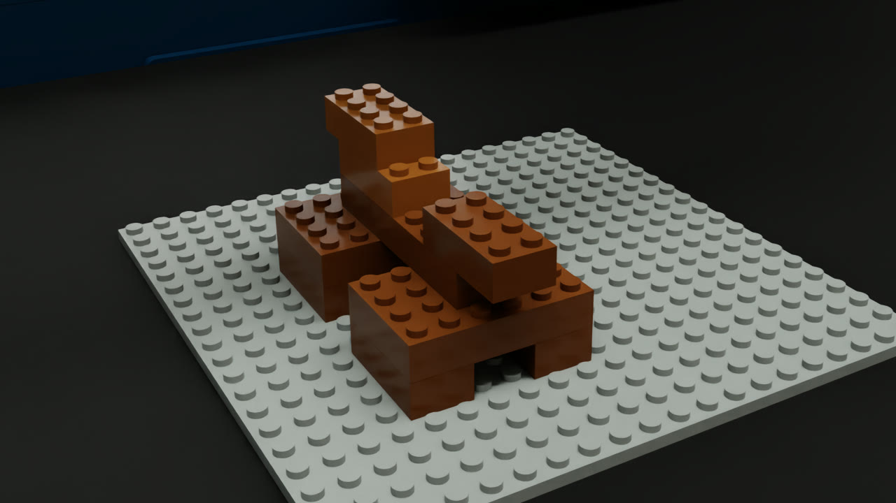](docs/media/dog_breakage_on.mp4) | [](docs/media/bridge.mp4) |
| Four legs, a wide body bridging them, neck, head and tail. | Stepped piers and a deck that spans the arch. |

| House, 8 bricks | Log cabin, 8 bricks |
|---|---|
| [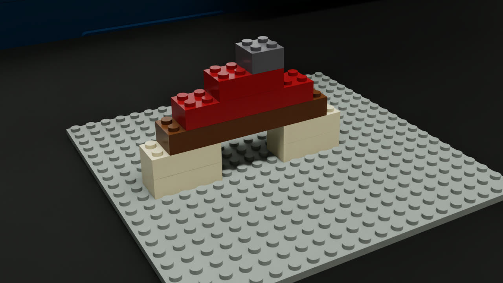](docs/media/house.mp4) | [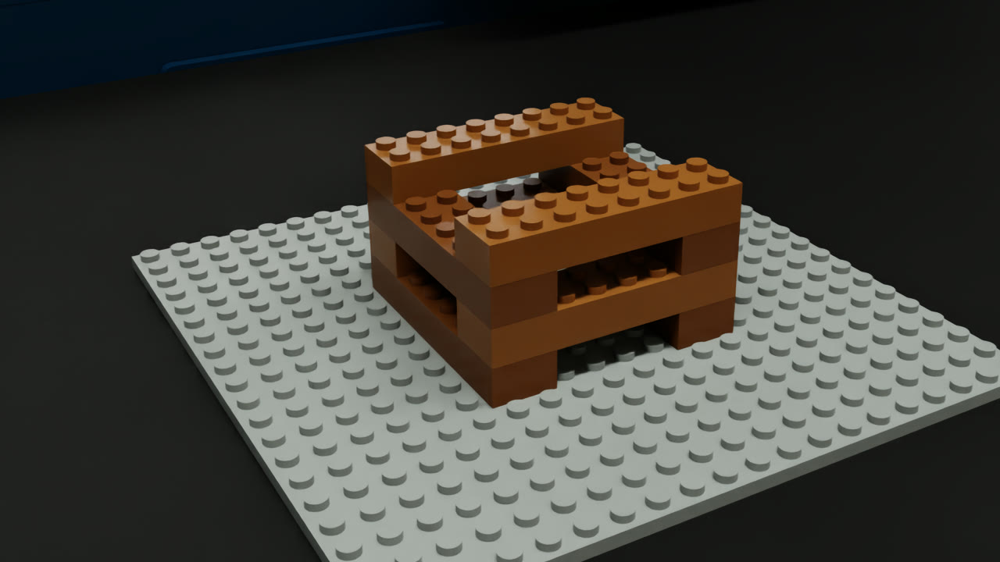](docs/media/log_cabin.mp4) |
| A doorway, a lintel across it, a stepped roof and a chimney. It completes with a 2 s gripper release; at the default 1 s, a wall joint breaks. | Courses alternate direction; every log interlocks two corners. |

**[Structure catalog →](docs/STRUCTURES.md)** has all 28 structures. Each one
has its design, its picture in simulation, its bricks and joints, the latest
result and a video.

## Breaking it on purpose

Break tests push one failure mechanism at a time, most with a control that
completes. In the cantilever, a 2x6 rests by one end on a column of 2x2 bricks.
Pressing a brick onto its free tip overloads the joint below, and the
cantilever tips over.


| Two bricks at the tip: fails | The same bricks over the support: completes |
|---|---|
| [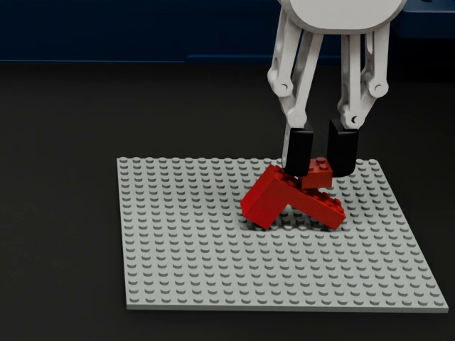](docs/media/cantilever_tip2.mp4) | [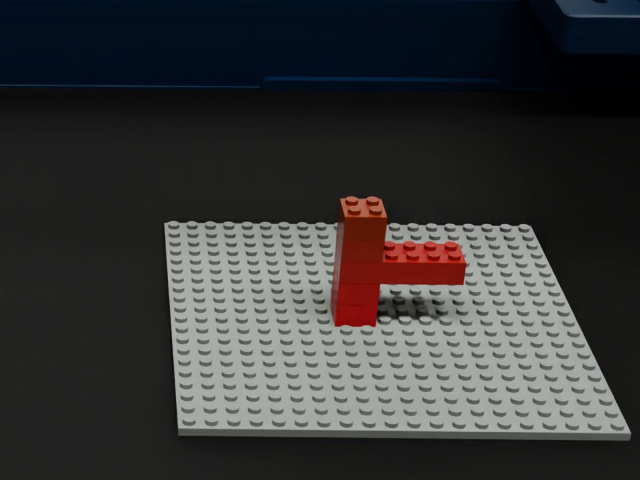](docs/media/cantilever_root2.mp4) |

| Column pressed at 3 N: base joint lost | Leaning ladder: collapses |
|---|---|
| [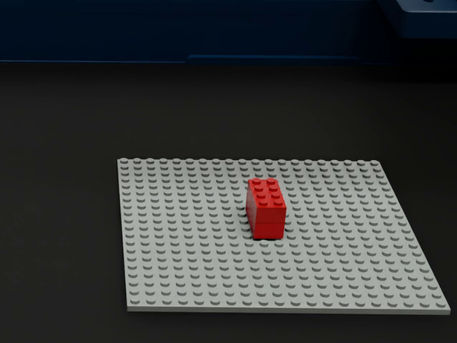](docs/media/column_press_3N.mp4) | [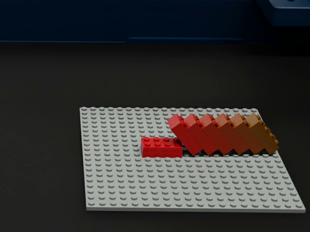](docs/media/lean_ladder.mp4) |
| It holds at 1 and 2 N and fails at 3 and 5 N, on the release after the press. | Each brick shifts one stud; the lean grows until a low joint fails. |

## When complex builds fail

Some failures were not planned. They came from trying harder structures, and
each is now a test case.

| Table: no room for the fingers | Cross-bonded tower: solver trouble |
|---|---|
| [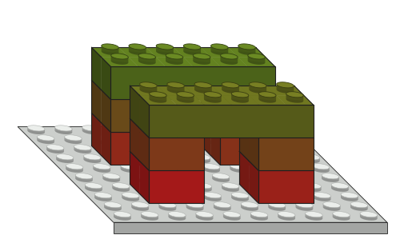](docs/STRUCTURES.md#table) | [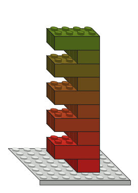](docs/STRUCTURES.md#cross_tower) |
| Legs 2 studs apart leave the RG2 no room to let go, so the controller stops rather than hit a leg. | The second joint breaks after four breakage-solver non-convergences. It is a simulator issue, not a clear overload. |

| Giraffe: the neck levers the base | Mixed tower: a brick does not seat |
|---|---|
| [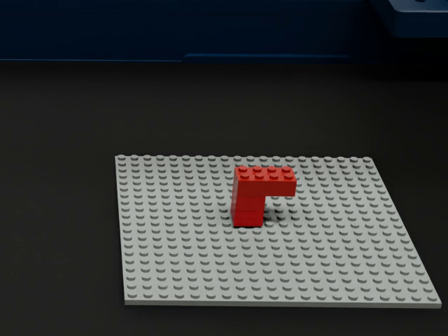](docs/media/giraffe.mp4) | [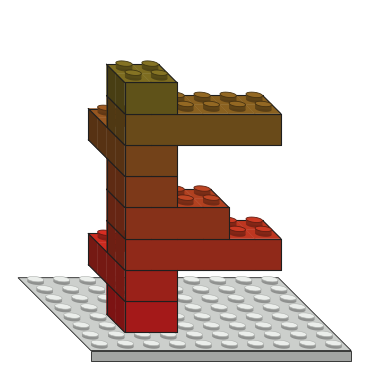](docs/STRUCTURES.md#mixed_tower) |
| Pressing the neck onto the end of the body pries the 4-stud base joint loose. | The brick stops on the studs 1 mm above its seat. |

Designs drawn from the config are marked by their white background. The other
pictures are the simulation.

## How a run is judged

Each run records the robot, every brick's pose and joint, the load on each
joint and a video. Its summary keeps apart:
- what stopped the controller;
- what the breakage model did: joints that broke for good, and joints that
  broke and re-formed at once;
- whether the breakage solver was struggling;
- whether the gripper touched another brick.

The details are in:
- [FAILURES.md](experiments/ur5e_structures/FAILURES.md): mechanisms and proposed
  real-robot tests;
- the [sweep summaries](experiments/ur5e_structures/sweeps/README.md): every
  run with its settings;
- [docs/EVALUATION_PRACTICES.md](docs/EVALUATION_PRACTICES.md): what carries
  over to Jenga.

The [dashboard](experiments/ur5e_dashboard/README.md)'s **Structures** view shows
each structure layer by layer, with every trial:

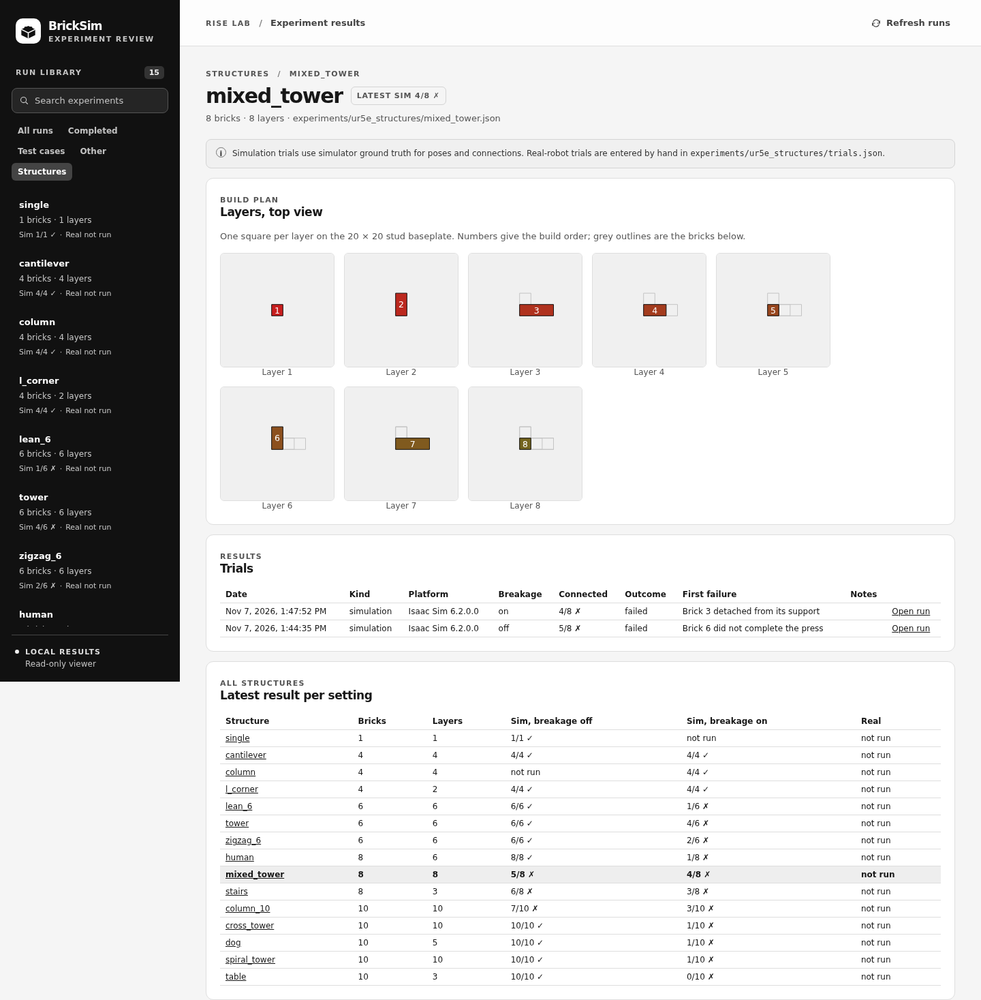

## Roadmap (planned)

The main research direction is Jenga with MPC and RL, developed in separate
projects. This repository remains the demo and a supporting contact-physics and
evaluation testbed.

1. Build larger structures in simulation and document each one in the catalog
   and dashboard.
2. Build the same structures on the real UR5e and compare what fails against
   simulation.
3. Close the telemetry gaps the sweeps found: log the breaking solve, record
   joint events in the recording, and check the grasp during transfer.

## Requirements

- x86-64 Linux with glibc ≥ 2.35 (Ubuntu 22.04+).
- An NVIDIA driver that meets the
  [Isaac Sim 6.2 requirements](https://docs.isaacsim.omniverse.nvidia.com/6.2.0/installation/requirements.html#system-requirements).
- [`uv`](https://docs.astral.sh/uv/getting-started/installation/) and
  [`pixi`](https://pixi.prefix.dev/latest/installation/).

## Build

```bash
git clone https://github.com/kalebcoleman/contact-assembly-lab.git
cd contact-assembly-lab
export CONDA_OVERRIDE_GLIBC=2.39   # only on glibc < 2.39 hosts, e.g. Ubuntu 22.04
pixi run build-native
uv sync --locked
```

[docs/ISAACSIM_6.2_PORT.md](docs/ISAACSIM_6.2_PORT.md) explains the glibc
override, the version changes (Kit 110.4, omni.physx 110.4.4, PhysX SDK 5.9.2,
torch 2.11 cu130) and how the Isaac Sim SDK pins are regenerated.

The UR5e experiments also need the lab assets (UR5e with `tool0`, RG2 gripper,
Vention bench) and an `isaac-mcp` checkout; see
[experiments/ur5e_lego/README.md](experiments/ur5e_lego/README.md).

## Build a structure

```bash
OMNI_KIT_ACCEPT_EULA=YES bash experiments/ur5e_dog/run_loop.sh \
  --attempts 1 --config experiments/ur5e_structures/column.json
```

Each attempt starts a fresh scene. Console logs and outcomes go to
`outputs/ur5e_dog/<time>/`, per-step recordings to `outputs/ur5e_lego/`.
`--attempts` takes 1–5; the loop stops at the first failure. Structures are in
[experiments/ur5e_structures/](experiments/ur5e_structures/README.md); the
ten-piece dog (the default config) is in
[experiments/ur5e_dog/](experiments/ur5e_dog/README.md), with results in
[RESULTS.md](experiments/ur5e_dog/RESULTS.md).

Controller settings (environment variables, read in
`experiments/ur5e_dog/controller.py` and `run.py`):

| Variable | Default | Effect |
|---|---|---|
| `DOG_BREAKAGE` | `1` | `0` disables breakage, so joints cannot break under load |
| `DOG_REQUIRED_FORCE_N` | `1.0` | Press force (N) needed to form a connection |
| `DOG_PRESS_DEPTH_M` | `0.0005` | Press target below the seated pose (m) |
| `DOG_PRESS_HOLD_S` | `0.05` | Time (s) a connection must hold before release |
| `DOG_FREEZE_ON_CONNECTION` | `1` | Stop descending once the connection forms |
| `DOG_RELEASE_RAMP_S` | `1.0` | Gripper opening time (s) |
| `DOG_HOLD_S` | `10` | Time (s) the finished structure stays on screen |

## Case suite

Thirteen single-case experiments (C01–C13), each with a prediction written
before it runs; see
[experiments/ur5e_lego/docs/ur5e-cases.md](experiments/ur5e_lego/docs/ur5e-cases.md).

```bash
.venv/bin/python experiments/ur5e_lego/scripts/run_ur5e_cases.py
.venv/bin/python experiments/ur5e_lego/scripts/run_ur5e_cases.py --case C01 C05
```

## Dashboard

```bash
python3 experiments/ur5e_dashboard/server.py
```

Open http://127.0.0.1:8765. The read-only viewer lists recorded runs and the
case suite; Isaac Sim need not be running. See
[experiments/ur5e_dashboard/README.md](experiments/ur5e_dashboard/README.md).

## Development

```bash
pixi run build-native          # rebuild after C++ changes
pixi run test-native-release   # and test-native-debug
uv run ruff check
python3 -m unittest experiments.ur5e_dog.test_geometry
python3 -m unittest discover -s experiments/ur5e_dashboard -p 'test_*.py'
python3 -m unittest experiments.ur5e_structures.test_summarize_sweep
.venv/bin/python -m unittest experiments.ur5e_structures.test_catalog
.venv/bin/python -m experiments.ur5e_structures.catalog   # regenerate docs/STRUCTURES.md
```

Coding rules are in [AGENTS.md](AGENTS.md).

## Repository layout

| Path | Contents |
|---|---|
| `native/` | C++26 native extension: brick connection and breakage physics, PhysX 5.9.2 patches, tests |
| `python/bricksim/` | Isaac Sim extension, launcher and Python API |
| `experiments/ur5e_dog/` | UR5e assembly controller and fresh-scene attempt loop |
| `experiments/ur5e_structures/` | Structure specs (JSON), sweeps and their summaries, failure catalogue |
| `experiments/ur5e_lego/` | UR5e scene, recording format, case suite C01–C13 |
| `experiments/ur5e_dashboard/` | Results dashboard |
| `docs/ISAACSIM_6.2_PORT.md` | Isaac Sim 5.1 → 6.2 changes and rebuild notes |
| `docs/STRUCTURES.md` | Structure catalog: design, picture, result and video of every structure |
| `docs/EVALUATION_PRACTICES.md` | Telemetry and evaluation practices for the Jenga work |
| `scripts/` | Native build, Isaac Sim pin resolver, environment parity check |

## Citation

```
@article{wen2026bricksim,
    title = {BrickSim: A Physics-Based Simulator for Manipulating Interlocking Brick Assemblies},
    author = {Wen, Haowei and Liu, Ruixuan and Piao, Weiyi and Li, Siyu and Liu, Changliu},
    journal = {arXiv:2603.16853},
    year = {2026},
    eprint = {2603.16853},
    archiveprefix = {arXiv},
    primaryclass = {cs.RO},
    url = {https://arxiv.org/abs/2603.16853}
}
```

## License

MIT, see [LICENSE](LICENSE). The original BrickSim copyright notice is retained
there; changes in this repository are released under the same license.
