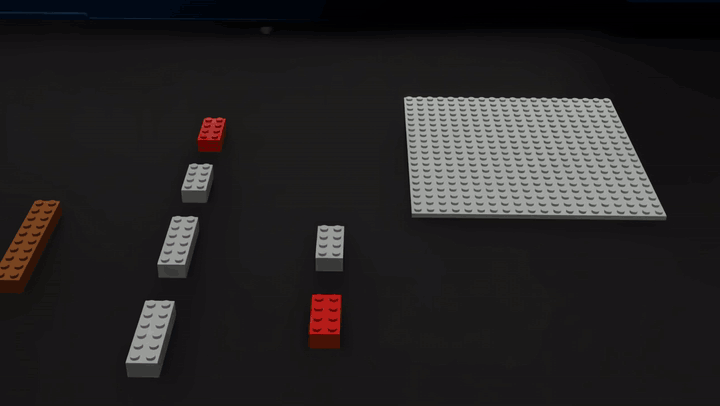
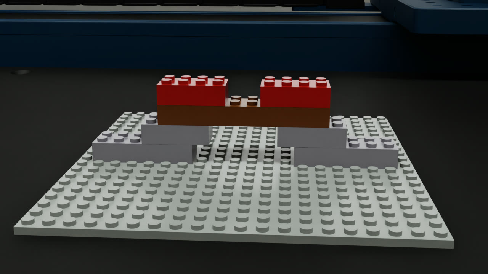
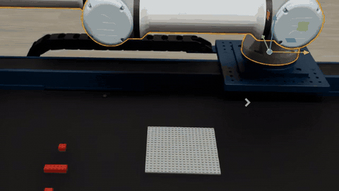
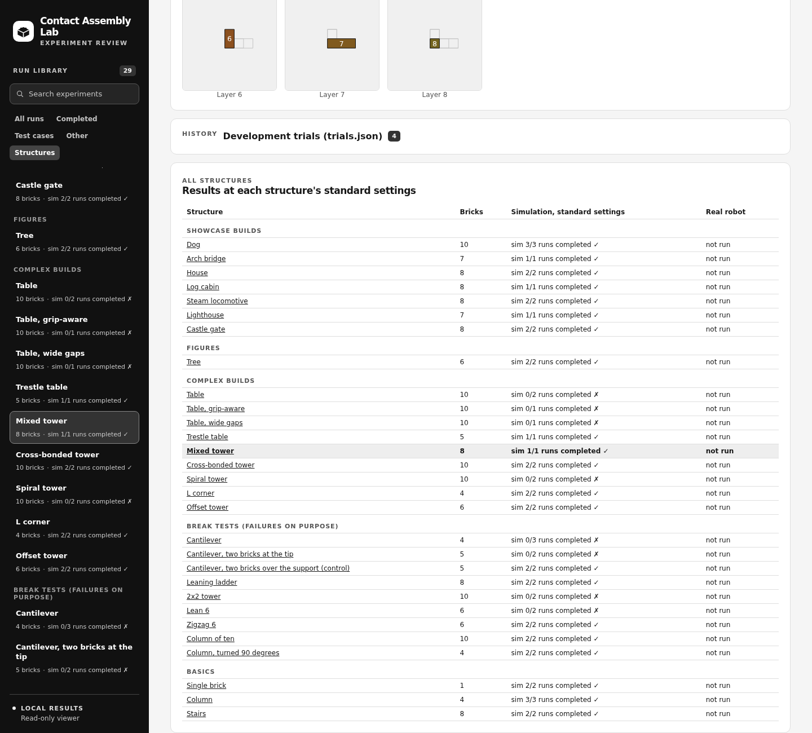
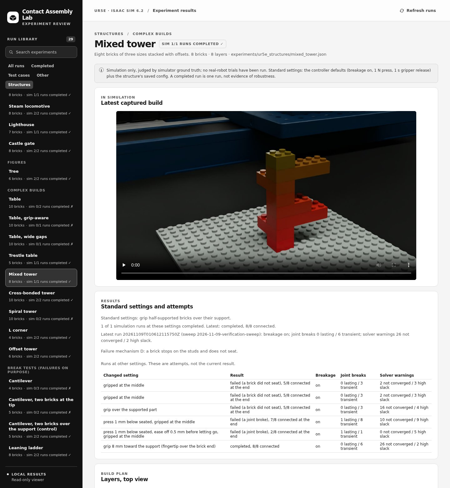
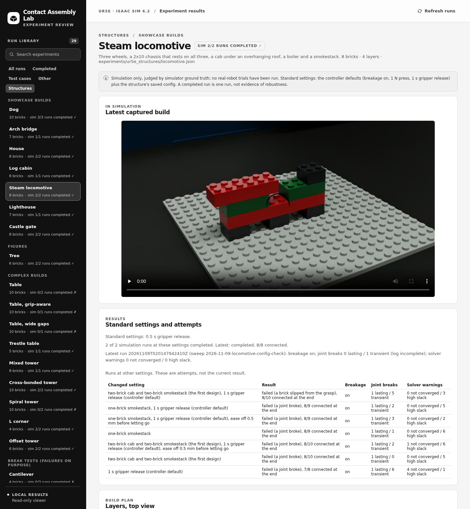
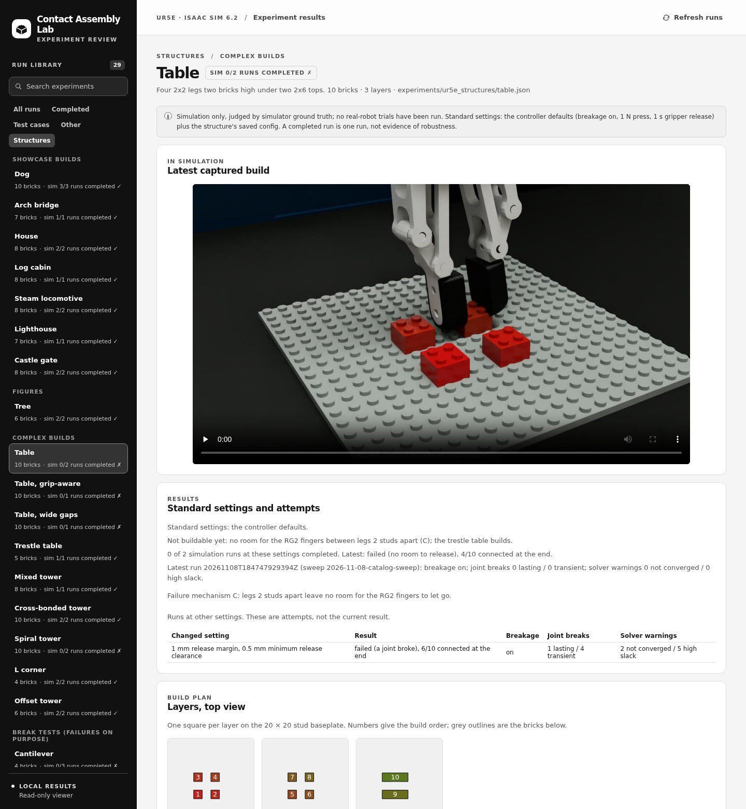
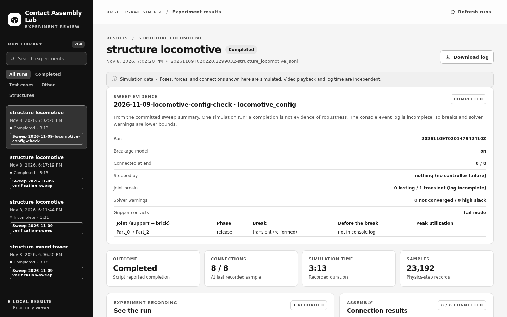
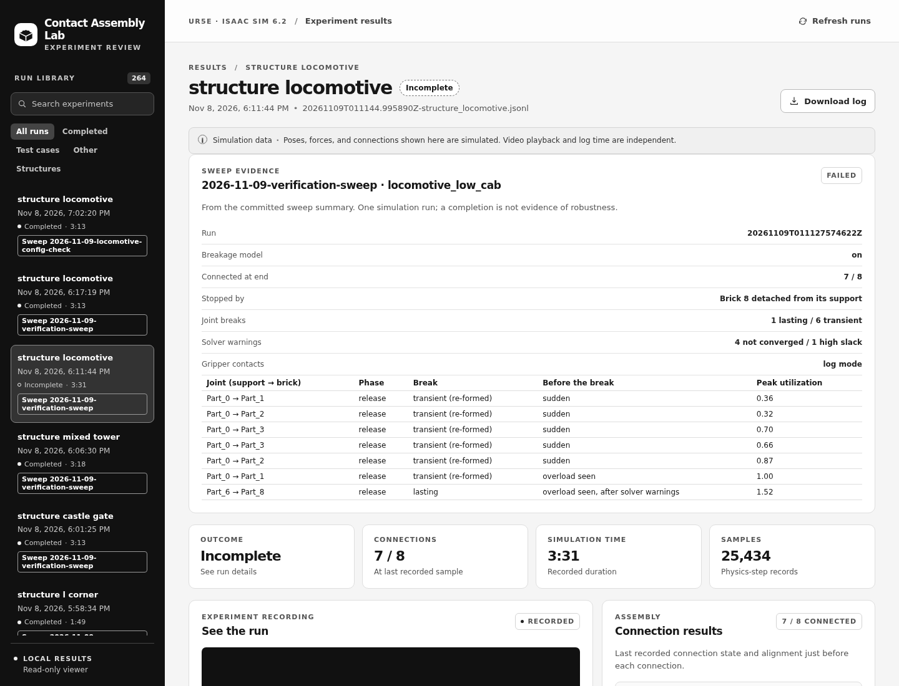

# Contact Assembly Lab

### A contact-rich robotic assembly digital-twin testbed in Isaac Sim 6.2

**Kaleb Coleman**

[Structure catalog](docs/STRUCTURES.md) ·
[Failure analysis](experiments/ur5e_structures/FAILURES.md) ·
[Assembly controller](experiments/ur5e_assembly/README.md) ·
[Usage and reproduction](docs/USAGE.md) ·
[Isaac Sim 6.2 port](docs/ISAACSIM_6.2_PORT.md) ·
[Citation](#citation)

[](https://docs.isaacsim.omniverse.nvidia.com/6.2.0/index.html)
[](https://docs.python.org/3.12/)
[](LICENSE)
[](https://github.com/intelligent-control-lab/BrickSim)



Contact Assembly Lab is a digital-twin testbed for contact-rich robotic assembly
in NVIDIA Isaac Sim 6.2. A UR5e arm with an RG2 gripper assembles structures
from interlocking parts, and BrickSim's joint-strength model decides, at every
physics step, whether each stud connection holds. The project asks what a robot
can assemble reliably and why builds fail, and it is the contact-physics testbed
for my research on Jenga with MPC and RL. All results are simulation; no
real-robot trials have been run.

## Showcase

Each picture links to its video, rendered in the simulator.

<!-- showcase:start -->
| Dog, 10 bricks | Arch bridge, 7 bricks |
|---|---|
| [](docs/media/dog_breakage_on.mp4) | [](docs/media/bridge.mp4) |
| Legs, a wide body bridging them, a neck, a head and a tail. | Stepped piers and a deck that lands on both. |

| House, 8 bricks | Log cabin, 8 bricks |
|---|---|
| [](docs/media/house.mp4) | [](docs/media/log_cabin.mp4) |
| A doorway, a lintel across it, a stepped roof and a chimney. Builds when the arm eases off before letting go. | Every log interlocks two corners. |

| Lighthouse, 7 bricks | Castle gate, 8 bricks |
|---|---|
| [](docs/media/lighthouse.mp4) | [](docs/media/castle_gate.mp4) |
| A striped tower on a rock, a lamp and a cap: seven layers. | Two towers, a lintel over the gate and battlements. Builds with an eased-off, faster release. |

| Steam locomotive, 8 bricks | Trestle table, 5 bricks |
|---|---|
| [](docs/media/locomotive.mp4) | [](docs/media/trestle_table.mp4) |
| Three wheels under a long chassis, a cab, a boiler and a smokestack. Builds with a faster release. | Slab legs gripped end to end, so the fingers stay out of the gap under the top. |
<!-- showcase:end -->

**[All structures →](docs/STRUCTURES.md)** For each one the catalog gives the
design, the simulated build, the bricks and joints, how many runs completed,
and a video.

## Failures

Every structure was first built with the same controller settings. When one
failed, the run showed where and why, and it was tried again with a different
release, grip or design. Some failures are planned break tests: the cantilever
below tips over when a brick is pressed onto its free end.



<!-- failures:start -->
| What went wrong | What fixed it | Now builds |
|---|---|---|
| A joint breaks as the gripper opens: the arm is still pushing | Ease off 0.5 mm before letting go | tree, offset tower, house |
| A joint breaks as the gripper opens: load builds while it opens | Let go faster (0.5 s instead of 1 s) | column of ten, cross-bonded tower, zigzag, leaning ladder, L corner, steam locomotive |
| Both of the above | Both fixes together | castle gate |
| A half-supported brick tips and never seats | Grip and press it over its support | mixed tower |
| No room for the fingers beside a brick | Grip the brick end to end | trestle table |

**Still not buildable:**
- the original table: no room for the fingers;
- the wide-gap table, spiral tower, 2x2 tower and lean 6: their 4-stud joints
  break;
- both cantilevers: they need building as a sub-assembly.

Where each structure fails, every attempt and how many runs it took are in
[FAILURES.md](experiments/ur5e_structures/FAILURES.md).
<!-- failures:end -->

## Dashboard

A local, read-only viewer for every run: each structure layer by layer, its
sweep results, and per-step recordings. Isaac Sim need not be running.

```bash
python3 experiments/ur5e_dashboard/server.py   # then open http://127.0.0.1:8765
```

All results are simulation; no real-robot trials have been run. A completed run
is one run, not evidence of robustness. Screenshots were captured on 2026-11-08
in Chromium at 1440 px wide, from the committed sweep summaries at `e00e603`.
Times are shown in the viewer's local time (MST).

| | |
|---|---|
|  |  |
| All 29 catalog structures with their simulation runs at standard settings (controller defaults plus each structure's saved config). | Mixed tower: 1/1 completed, verification run `20261109T010612115750Z`, 0 lasting / 6 transient breaks, 26 non-converged / 2 high-slack solver warnings. Earlier failures are listed as attempts. |
|  |  |
| Locomotive: 2/2 completed with its saved 0.5 s release; latest is the config-check run `20261109T020147942410Z` (0 lasting / 1 transient break, 0 solver warnings, event log incomplete). The 1 s default failed 7/8. | Table: not buildable yet (no room for the RG2 fingers between legs 2 studs apart); 0/2 completed. |
|  |  |
| Run library: each recording tagged with its sweep; the locomotive config-check run with its sweep evidence. | Locomotive at the 1 s default release (`20261109T011127574622Z`): failed 7/8, 1 lasting / 6 transient breaks, 4 non-converged / 1 high-slack warnings, each removed joint. The recording reads "Incomplete" because the run raised before writing its end record. |

## Reproducibility

- **Every run is recorded.** Each sweep definition names the configs, the
  settings and the controller commit, and its generated summary lists every
  run's outcome, joint breaks and solver warnings
  ([sweeps](experiments/ur5e_structures/sweeps/README.md)).
- **Runs are deterministic.** Repeating a structure gave identical results on
  the reference machine (Ubuntu 22.04, RTX PRO 6000 Blackwell, Isaac Sim
  6.2.0.0, PhysX 5.9.2).
- **One command re-runs a sweep** into a fresh copy, for comparison with the
  committed summary:

  ```bash
  OMNI_KIT_ACCEPT_EULA=YES python3 -m experiments.ur5e_structures.run_sweep \
    experiments/ur5e_structures/sweeps/2026-11-08-showcase-sweep.json \
    --rerun experiments/ur5e_structures/sweeps/my-rerun.json --capture
  ```

- **One requirement is outside this repository.** The UR5e, gripper and bench
  models come from a separate asset store, pinned by hash.

Build steps, the exact stack and all commands:
[docs/USAGE.md](docs/USAGE.md).

## My version

This repository builds on [BrickSim](https://github.com/intelligent-control-lab/BrickSim)
by Haowei Wen, Ruixuan Liu, Weiyi Piao, Siyu Li and Changliu Liu (Intelligent
Control Lab, Carnegie Mellon University), released under the MIT License. The
brick connection and breakage physics, the C++ native extension and the
simulator UI are theirs. This version adds:
- **the Isaac Sim 6.2 port**, from 5.1 / Python 3.11 to 6.2.0.0 / Python 3.12
  ([notes](docs/ISAACSIM_6.2_PORT.md));
- **a weld-torque correction** for PhysX 5.9's CPU TGS solver, which
  misreported the loads the breakage model reads;
- **a UR5e assembly controller** that builds any structure config, releases
  bricks without touching their neighbours and logs every gripper contact
  ([controller](experiments/ur5e_assembly/README.md));
- **the structure library** of 29 structures, its design renderer and
  the [catalog](docs/STRUCTURES.md);
- **reproducible sweeps**, run summaries that separate physics failures from
  numerical and controller ones, and the failure analysis;
- **the dashboard**.

## Roadmap

1. Grip bricks in more ways (across the long side, re-grasping) to remove the
   gripper limits found so far.
2. Add more part types, such as plates, 1-wide parts and offsets, for more
   complex builds.
3. Build the same structures on the real UR5e and compare what fails.
4. Carry the evaluation methods over to Jenga
   ([notes](docs/EVALUATION_PRACTICES.md)).

## Citation

If you use this work, please cite it and BrickSim, which it builds on.

```bibtex
@software{coleman2026contactassemblylab,
    title = {Contact Assembly Lab: A Contact-Rich Robotic Assembly Testbed with Joint-Strength Physics in Isaac Sim 6.2},
    author = {Coleman, Kaleb},
    year = {2026},
    url = {https://github.com/kalebcoleman/contact-assembly-lab}
}
```

```bibtex
@article{wen2026bricksim,
    title = {BrickSim: A Physics-Based Simulator for Manipulating Interlocking Brick Assemblies},
    author = {Wen, Haowei and Liu, Ruixuan and Piao, Weiyi and Li, Siyu and Liu, Changliu},
    journal = {arXiv:2603.16853},
    year = {2026},
    eprint = {2603.16853},
    archiveprefix = {arXiv},
    primaryclass = {cs.RO},
    url = {https://arxiv.org/abs/2603.16853}
}
```

## License

MIT, see [LICENSE](LICENSE). The original BrickSim copyright notice is retained
there; changes in this repository are released under the same license.
