# Structure catalog (simulation)

Generated by `experiments/ur5e_structures/catalog.py`; do not edit by hand.

Every structure the UR5e builds in Isaac Sim 6.2. Each entry shows:
- the design, drawn from the config;
- the structure in simulation at the end of its latest captured run;
- its bricks and joints;
- its results.

**Runs** counts the sweep runs at each structure's standard settings: the
controller defaults (breakage on, 1 N press, 1 s release, gripper
contacts logged) plus anything its config adds, shown as *Builds with*.
Runs at other settings are listed in each entry as attempts. Repeated
runs of a structure give the same result, because the simulation is
deterministic. These are simulation results
judged by simulator ground truth; nothing here ran on hardware.

The failures are explained in
[FAILURES.md](../experiments/ur5e_structures/FAILURES.md), and every
run's settings are in the
[sweep summaries](../experiments/ur5e_structures/sweeps/README.md).

| Structure | Bricks | Runs | Completed | Latest |
|---|---|---|---|---|
| **Showcase builds** | | | | |
| [Dog](#dog) | 10 | 3 | 3 | completed |
| [Arch bridge](#bridge) | 7 | 1 | 1 | completed |
| [House](#house) | 8 | 2 | 2 | completed |
| [Log cabin](#log_cabin) | 8 | 1 | 1 | completed |
| [Steam locomotive](#locomotive) | 8 | 1 | 1 | completed |
| [Lighthouse](#lighthouse) | 7 | 1 | 1 | completed |
| [Castle gate](#castle_gate) | 8 | 2 | 2 | completed |
| **Figures** | | | | |
| [Tree](#tree) | 6 | 2 | 2 | completed |
| **Complex builds** | | | | |
| [Table](#table) | 10 | 2 | 0 | failed |
| [Table, grip-aware](#table_grip) | 10 | 1 | 0 | failed |
| [Table, wide gaps](#table_wide) | 10 | 1 | 0 | failed |
| [Trestle table](#trestle_table) | 5 | 1 | 1 | completed |
| [Mixed tower](#mixed_tower) | 8 | 1 | 1 | completed |
| [Cross-bonded tower](#cross_tower) | 10 | 2 | 2 | completed |
| [Spiral tower](#spiral_tower) | 10 | 2 | 0 | failed |
| [L corner](#l_corner) | 4 | 2 | 2 | completed |
| [Offset tower](#tower) | 6 | 2 | 2 | completed |
| **Break tests (failures on purpose)** | | | | |
| [Cantilever](#cantilever) | 4 | 3 | 0 | failed |
| [Cantilever, two bricks at the tip](#cantilever_tip2) | 5 | 2 | 0 | failed |
| [Cantilever, two bricks over the support (control)](#cantilever_root2) | 5 | 2 | 2 | completed |
| [Leaning ladder](#lean_ladder) | 8 | 2 | 2 | completed |
| [2x2 tower](#tower_2x2) | 10 | 2 | 0 | failed |
| [Lean 6](#lean_6) | 6 | 2 | 0 | failed |
| [Zigzag 6](#zigzag_6) | 6 | 2 | 2 | completed |
| [Column of ten](#column_10) | 10 | 2 | 2 | completed |
| [Column, turned 90 degrees](#column_turned) | 4 | 2 | 2 | completed |
| **Basics** | | | | |
| [Single brick](#single) | 1 | 2 | 2 | completed |
| [Column](#column) | 4 | 3 | 3 | completed |
| [Stairs](#stairs) | 8 | 2 | 2 | completed |

## Showcase builds

Recognisable structures that need distinctive steps.

### Dog

Ten bricks: four legs, a wide body bridging them, a neck, head and tail.

| Design | Simulation |
|---|---|
| 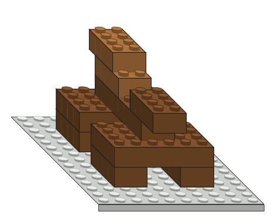 | 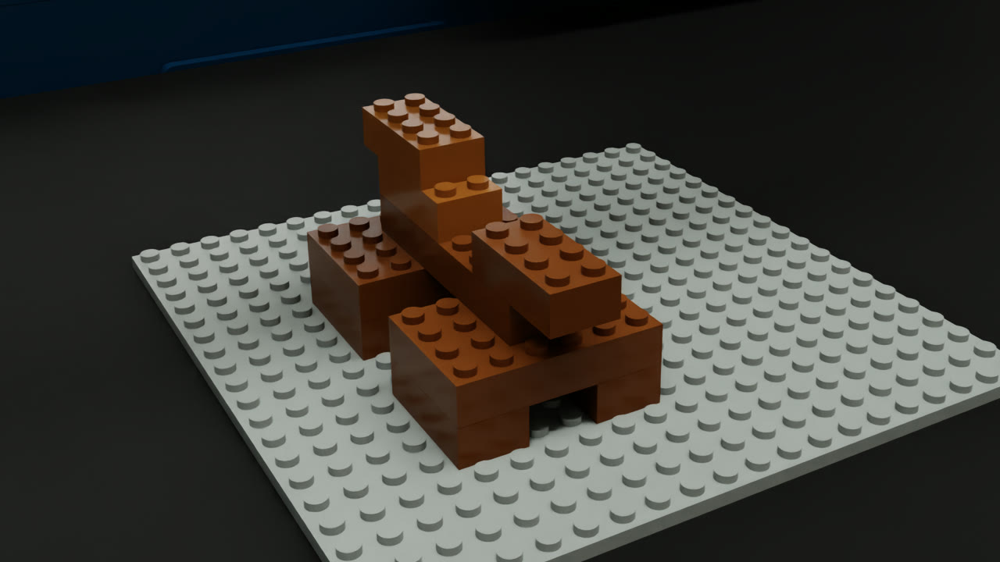 |

- **Bricks:** 10 (7× 2x4, 1× 2x8, 2× 4x6).
- **Layers:** 5.
- **Bricks resting on two or more bricks:** 3.
- **Weakest planned joint:** 4 studs.
- **Builds with:** the controller defaults.
- **Runs at these settings:** 3, 3 completed. Latest: completed, 10/10 connected.
- **Media:** [video (MP4)](media/dog_breakage_on.mp4) · [GIF](media/dog_breakage_on.gif) · [config](../experiments/ur5e_structures/dog.json)

### Arch bridge

A corbel arch: each pier steps one stud inward, then a 2x10 deck closes the arch by landing on both piers. Two parapets finish the deck.

| Design | Simulation |
|---|---|
| 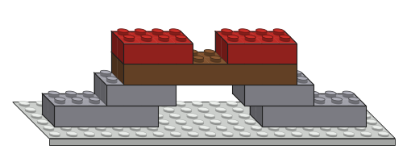 | 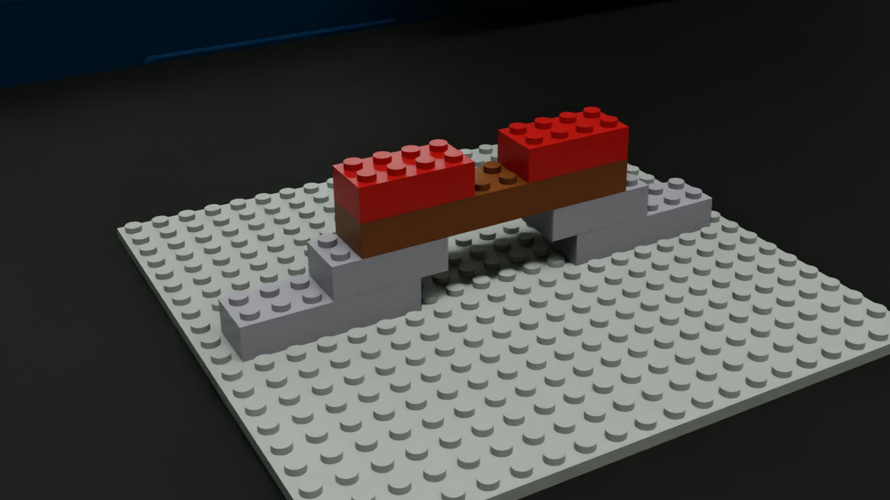 |

- **Bricks:** 7 (1× 2x10, 4× 2x4, 2× 2x6).
- **Layers:** 4.
- **Bricks resting on two or more bricks:** 1.
- **Weakest planned joint:** 6 studs.
- **Builds with:** the controller defaults.
- **Runs at these settings:** 1, 1 completed. Latest: completed, 7/7 connected.
- **Media:** [video (MP4)](media/bridge.mp4) · [GIF](media/bridge.gif) · [config](../experiments/ur5e_structures/bridge.json)

### House

A facade with a doorway. Two walls stand two courses high, a 2x10 lintel spans the door and lands on both walls, and a stepped gable roof and a chimney finish it.

| Design | Simulation |
|---|---|
| 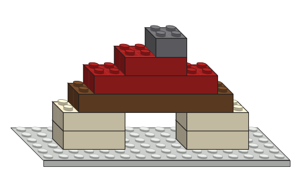 | 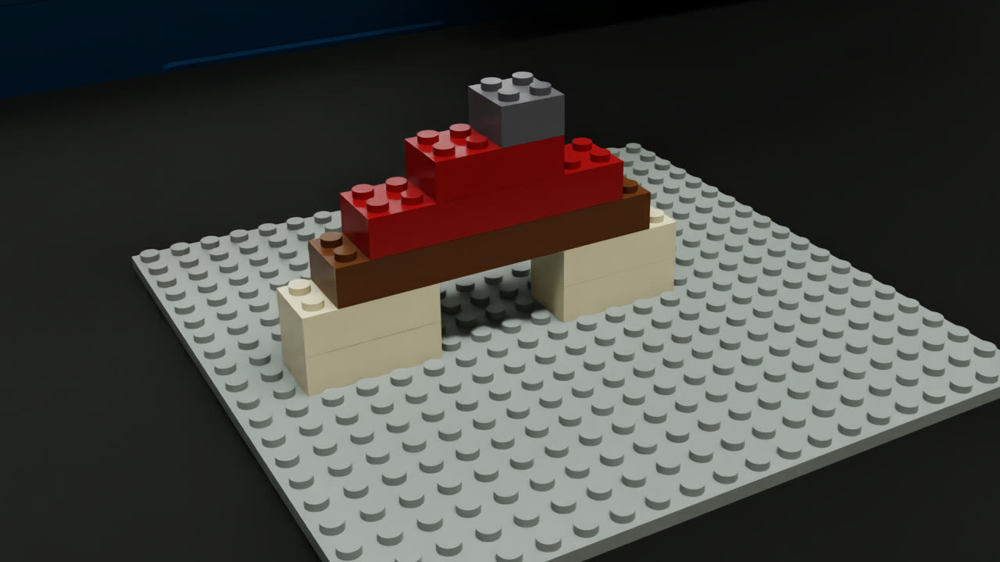 |

- **Bricks:** 8 (1× 2x10, 1× 2x2, 5× 2x4, 1× 2x8).
- **Layers:** 6.
- **Bricks resting on two or more bricks:** 1.
- **Weakest planned joint:** 4 studs.
- **Builds with:** ease off 0.5 mm before letting go.
- **Runs at these settings:** 2, 2 completed. Latest: completed, 8/8 connected.
- **Also tried (no easing off (controller default)):** failed (a joint broke), 2/8 connected at the end.
- **Also tried (2 s gripper release, no easing off (controller default)):** completed, 8/8 connected.
- **Also tried (press 0.2 mm below seated, no easing off (controller default)):** failed (a joint broke), 2/8 connected at the end.
- **Also tried (0.5 s gripper release, no easing off (controller default)):** completed, 8/8 connected.
- **Failure mechanism:** B: release load on an 8-stud wall joint. See [FAILURES.md](../experiments/ur5e_structures/FAILURES.md#mechanisms).
- **Media:** [video (MP4)](media/house.mp4) · [config](../experiments/ur5e_structures/house.json)

### Log cabin

Courses alternate direction, and every brick above the first interlocks two corners below. It is planned on one corner and lands on both.

| Design | Simulation |
|---|---|
| 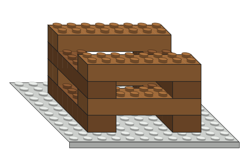 | 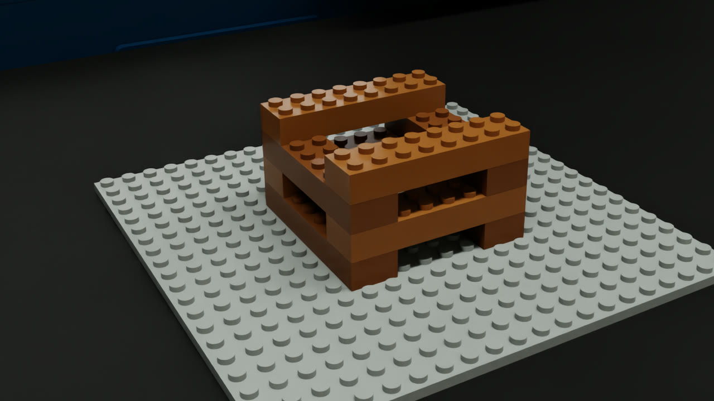 |

- **Bricks:** 8 (8× 2x8).
- **Layers:** 4.
- **Bricks resting on two or more bricks:** 6.
- **Weakest planned joint:** 4 studs.
- **Builds with:** the controller defaults.
- **Runs at these settings:** 1, 1 completed. Latest: completed, 8/8 connected.
- **Media:** [video (MP4)](media/log_cabin.mp4) · [config](../experiments/ur5e_structures/log_cabin.json)

### Steam locomotive

Three wheels, a 2x10 chassis that rests on all three, a cab under an overhanging roof, a boiler and a smokestack.

| Design | Simulation |
|---|---|
| 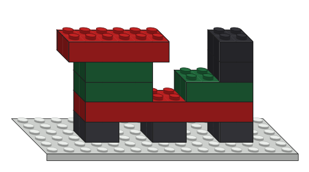 | 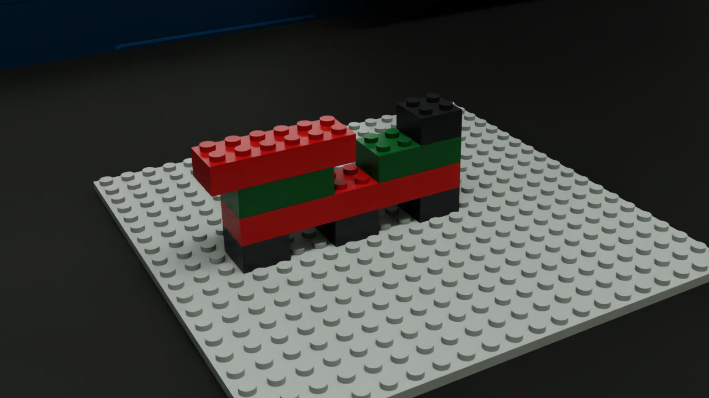 |

- **Bricks:** 8 (1× 2x10, 4× 2x2, 2× 2x4, 1× 2x6).
- **Layers:** 4.
- **Bricks resting on two or more bricks:** 1.
- **Weakest planned joint:** 4 studs.
- **Builds with:** 0.5 s gripper release.
- **Runs at these settings:** 1, 1 completed. Latest: completed, 8/8 connected.
- **Also tried (two-brick cab and two-brick smokestack (the first design), 1 s gripper release (controller default)):** failed (a brick slipped from the grasp), 8/10 connected at the end.
- **Also tried (one-brick smokestack, 1 s gripper release (controller default)):** failed (a joint broke), 8/9 connected at the end.
- **Also tried (one-brick smokestack, 1 s gripper release (controller default), ease off 0.5 mm before letting go):** failed (a joint broke), 8/9 connected at the end.
- **Also tried (one-brick smokestack):** failed (a joint broke), 8/9 connected at the end.
- **Also tried (two-brick cab and two-brick smokestack (the first design), 1 s gripper release (controller default), ease off 0.5 mm before letting go):** failed (a joint broke), 8/10 connected at the end.
- **Also tried (two-brick cab and two-brick smokestack (the first design)):** failed (a joint broke), 8/10 connected at the end.
- **Also tried (1 s gripper release (controller default)):** failed (a joint broke), 7/8 connected at the end.
- **Media:** [video (MP4)](media/locomotive.mp4) · [config](../experiments/ur5e_structures/locomotive.json)

### Lighthouse

A 4x6 rock, a tower striped red and white, a yellow lamp and a red cap: seven layers, the tallest showcase build.

| Design | Simulation |
|---|---|
| 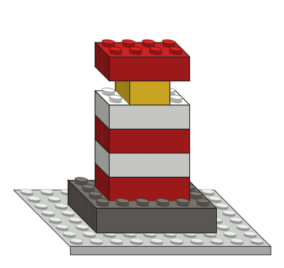 | 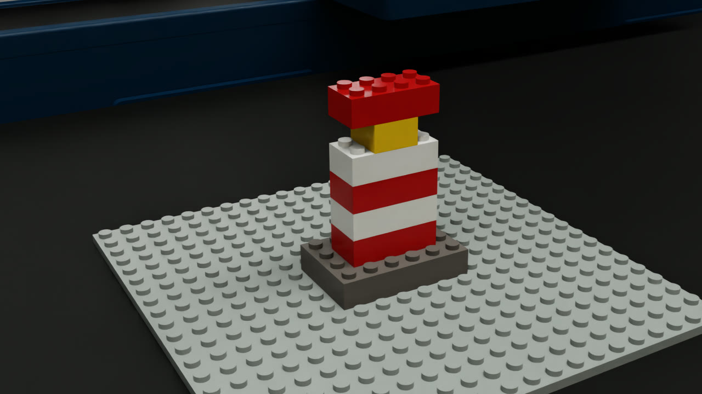 |

- **Bricks:** 7 (1× 2x2, 5× 2x4, 1× 4x6).
- **Layers:** 7.
- **Bricks resting on two or more bricks:** 0.
- **Weakest planned joint:** 4 studs.
- **Builds with:** the controller defaults.
- **Runs at these settings:** 1, 1 completed. Latest: completed, 7/7 connected.
- **Media:** [video (MP4)](media/lighthouse.mp4) · [config](../experiments/ur5e_structures/lighthouse.json)

### Castle gate

Two towers flank the gate, a 2x10 lintel spans it and lands on both towers, and three battlements line the top.

| Design | Simulation |
|---|---|
| 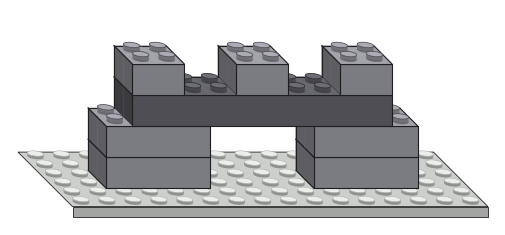 | 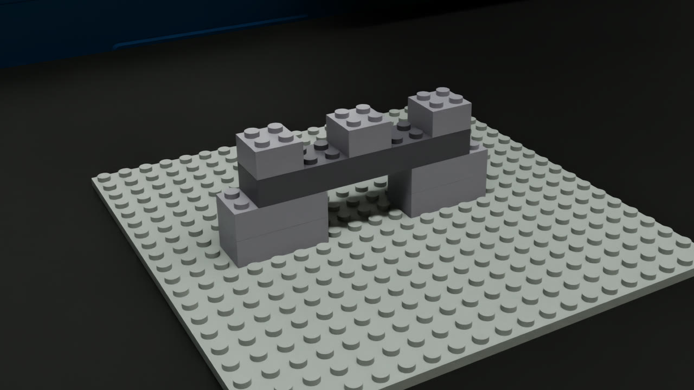 |

- **Bricks:** 8 (1× 2x10, 3× 2x2, 4× 2x4).
- **Layers:** 4.
- **Bricks resting on two or more bricks:** 1.
- **Weakest planned joint:** 4 studs.
- **Builds with:** ease off 0.5 mm before letting go, 0.5 s gripper release.
- **Runs at these settings:** 2, 2 completed. Latest: completed, 8/8 connected.
- **Also tried (1 s gripper release (controller default), no easing off (controller default)):** failed (a joint broke), 7/8 connected at the end.
- **Also tried (2 s gripper release, no easing off (controller default)):** failed (a joint broke), 3/8 connected at the end.
- **Also tried (1 s gripper release (controller default)):** failed (a joint broke), 7/8 connected at the end.
- **Also tried (no easing off (controller default)):** failed (a joint broke), 2/8 connected at the end.
- **Also tried (battlements over the towers only, 1 s gripper release (controller default), no easing off (controller default)):** completed, 7/7 connected.
- **Media:** [video (MP4)](media/castle_gate.mp4) · [config](../experiments/ur5e_structures/castle_gate.json)

## Figures

Smaller recognisable builds.

### Tree

A three-high 2x2 trunk under a crown of 2x6, 4x2 and 2x2 bricks.

| Design | Simulation |
|---|---|
| 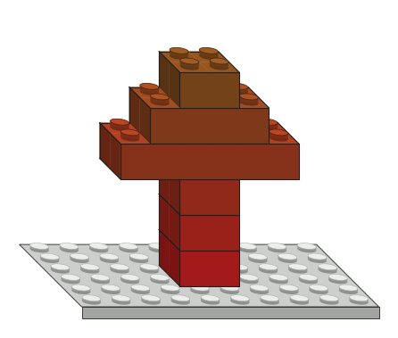 | 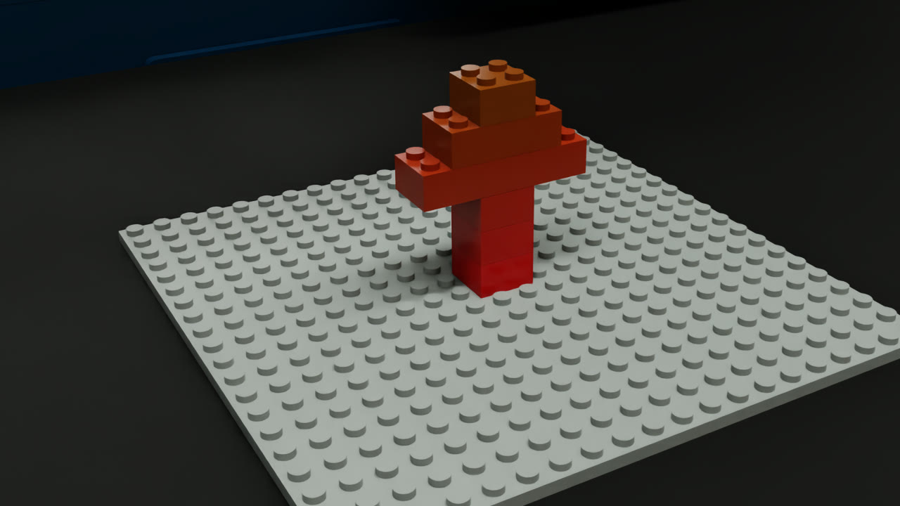 |

- **Bricks:** 6 (4× 2x2, 1× 2x4, 1× 2x6).
- **Layers:** 6.
- **Bricks resting on two or more bricks:** 0.
- **Weakest planned joint:** 4 studs.
- **Builds with:** ease off 0.5 mm before letting go.
- **Runs at these settings:** 2, 2 completed. Latest: completed, 6/6 connected.
- **Also tried (no easing off (controller default)) ×2:** failed (a joint broke), 5/6 connected at the end.
- **Also tried (2 s gripper release, no easing off (controller default)):** failed (a joint broke), 4/6 connected at the end.
- **Also tried (0.5 s gripper release, no easing off (controller default)):** failed (a joint broke), 1/6 connected at the end.
- **Failure mechanism:** B: the trunk's 4-stud base joint breaks on the releases, transiently, then for good. See [FAILURES.md](../experiments/ur5e_structures/FAILURES.md#mechanisms).
- **Media:** [video (MP4)](media/tree.mp4) · [config](../experiments/ur5e_structures/tree.json)

## Complex builds

Harder structures, some failing, with the variants tried to build them.

### Table

Four 2x2 legs two bricks high under two 2x6 tops.

| Design | Simulation |
|---|---|
| 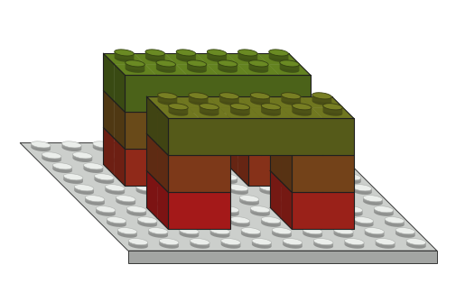 | 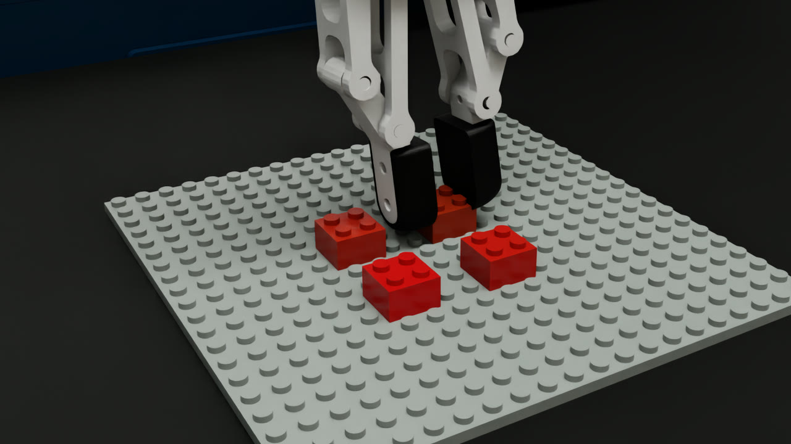 |

- **Bricks:** 10 (8× 2x2, 2× 2x6).
- **Layers:** 3.
- **Bricks resting on two or more bricks:** 2.
- **Weakest planned joint:** 4 studs.
- **Builds with:** the controller defaults.
- **Runs at these settings:** 2, 0 completed. Latest: failed (no room to release), 4/10 connected at the end.
- **Also tried (1 mm release margin, 0.5 mm minimum release clearance):** failed (a joint broke), 6/10 connected at the end.
- **Failure mechanism:** C: legs 2 studs apart leave no room for the RG2 fingers to let go. See [FAILURES.md](../experiments/ur5e_structures/FAILURES.md#mechanisms).
- **Media:** [video (MP4)](media/table.mp4) · [config](../experiments/ur5e_structures/table.json)

### Table, grip-aware

The table's ten bricks, with each grip chosen for room. The legs are gripped across the axis where they are 4 studs apart, and the 2x8 tops are gripped end to end, so no finger enters a 2-stud gap.

| Design | Simulation |
|---|---|
| 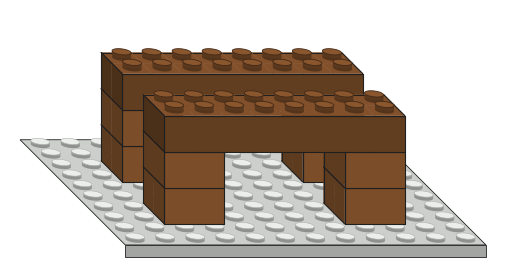 | 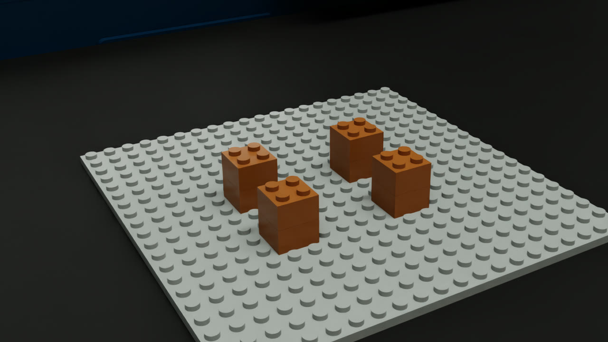 |

- **Bricks:** 10 (8× 2x2, 2× 2x8).
- **Layers:** 3.
- **Bricks resting on two or more bricks:** 2.
- **Weakest planned joint:** 4 studs.
- **Builds with:** the controller defaults.
- **Runs at these settings:** 1, 0 completed. Latest: failed (grasp failed), 8/10 connected at the end.
- **Media:** [video (MP4)](media/table_grip.mp4) · [config](../experiments/ur5e_structures/table_grip.json)

### Table, wide gaps

Four 2x2 legs two bricks high, 4 studs apart both ways, under two 2x8 tops gripped across their width.

| Design | Simulation |
|---|---|
| 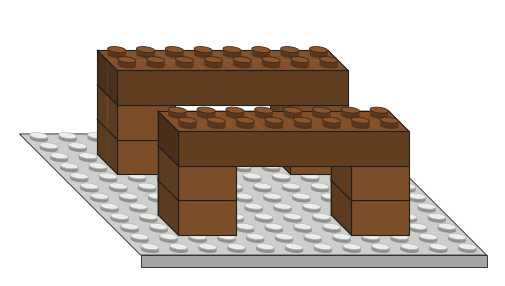 | 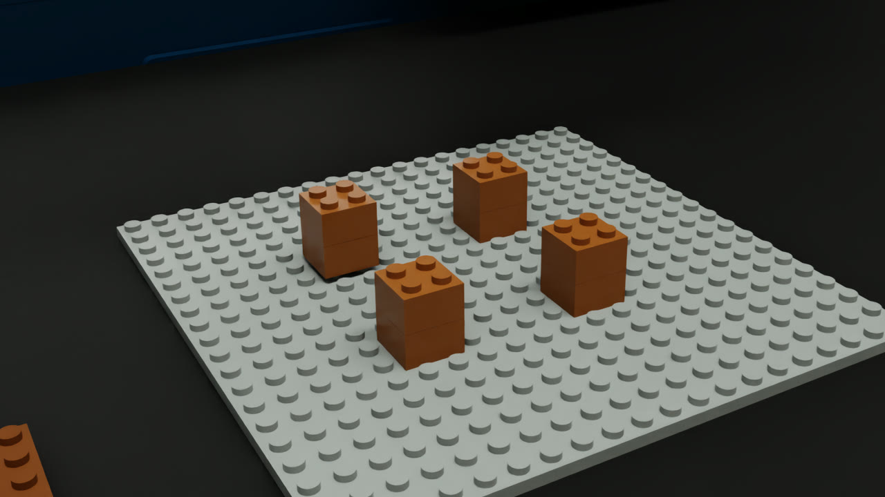 |

- **Bricks:** 10 (8× 2x2, 2× 2x8).
- **Layers:** 3.
- **Bricks resting on two or more bricks:** 2.
- **Weakest planned joint:** 4 studs.
- **Builds with:** the controller defaults.
- **Runs at these settings:** 1, 0 completed. Latest: failed (a joint broke), 7/10 connected at the end.
- **Also tried (ease off 0.5 mm before letting go):** failed (a joint broke), 8/10 connected at the end.
- **Also tried (0.5 s gripper release):** failed (a joint broke), 6/10 connected at the end.
- **Media:** [video (MP4)](media/table_wide.mp4) · [config](../experiments/ur5e_structures/table_wide.json)

### Trestle table

Two slab legs of 2x4 bricks gripped end to end under a 4x6 top.

| Design | Simulation |
|---|---|
| 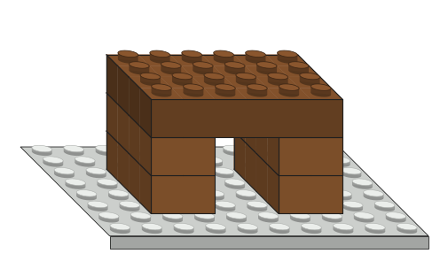 | 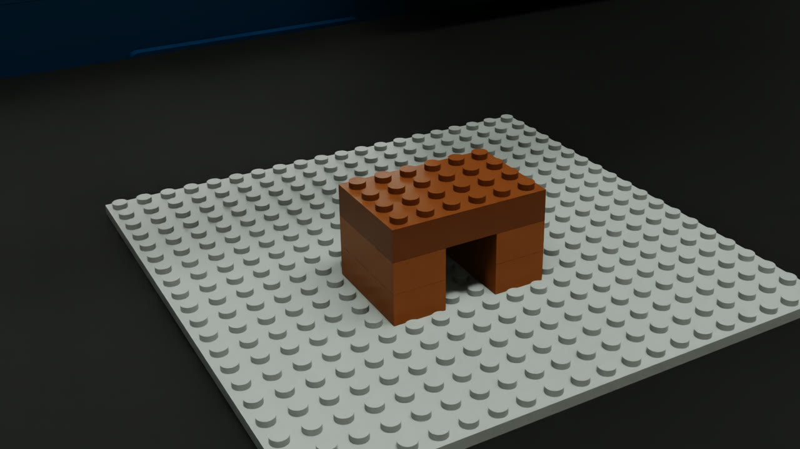 |

- **Bricks:** 5 (4× 2x4, 1× 4x6).
- **Layers:** 3.
- **Bricks resting on two or more bricks:** 1.
- **Weakest planned joint:** 8 studs.
- **Builds with:** the controller defaults.
- **Runs at these settings:** 1, 1 completed. Latest: completed, 5/5 connected.
- **Media:** [video (MP4)](media/trestle_table.mp4) · [config](../experiments/ur5e_structures/trestle_table.json)

### Mixed tower

Eight bricks of three sizes stacked with offsets.

| Design | Simulation |
|---|---|
| 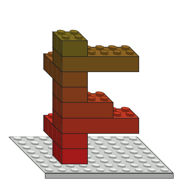 | 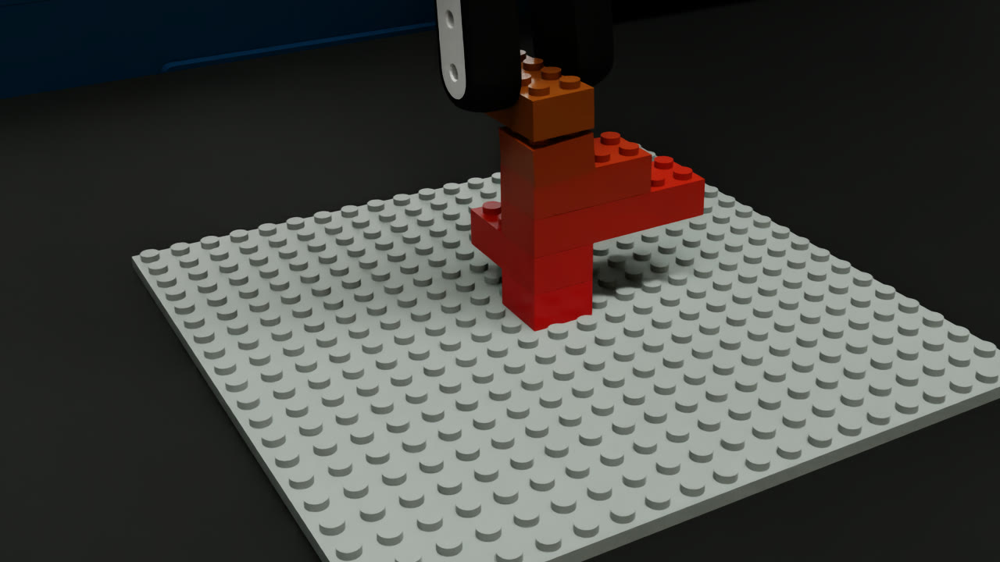 |

- **Bricks:** 8 (3× 2x2, 3× 2x4, 2× 2x6).
- **Layers:** 8.
- **Bricks resting on two or more bricks:** 0.
- **Weakest planned joint:** 4 studs.
- **Builds with:** grip half-supported bricks over their support.
- **Runs at these settings:** 1, 1 completed. Latest: completed, 8/8 connected.
- **Also tried (gripped at the middle) ×2:** failed (a brick did not seat), 5/8 connected at the end.
- **Also tried (grip over the supported part):** failed (a brick did not seat), 5/8 connected at the end.
- **Also tried (press 1 mm below seated, gripped at the middle):** failed (a joint broke), 7/8 connected at the end.
- **Also tried (press 1 mm below seated, ease off 0.5 mm before letting go, gripped at the middle):** failed (a joint broke), 2/8 connected at the end.
- **Also tried (grip 8 mm toward the support (fingertip over the brick end)):** completed, 8/8 connected.
- **Failure mechanism:** D: a brick stops on the studs and does not seat. See [FAILURES.md](../experiments/ur5e_structures/FAILURES.md#mechanisms).
- **Media:** [video (MP4)](media/mixed_tower.mp4) · [config](../experiments/ur5e_structures/mixed_tower.json)

### Cross-bonded tower

Ten 2x4 bricks alternating +90 and -90 degrees.

| Design | Simulation |
|---|---|
| 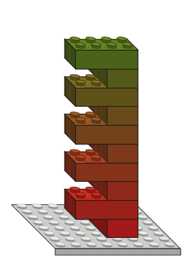 |  |

- **Bricks:** 10 (10× 2x4).
- **Layers:** 10.
- **Bricks resting on two or more bricks:** 0.
- **Weakest planned joint:** 4 studs.
- **Builds with:** 0.5 s gripper release.
- **Runs at these settings:** 2, 2 completed. Latest: completed, 10/10 connected.
- **Also tried (1 s gripper release (controller default)) ×2:** failed (a joint broke), 1/10 connected at the end.
- **Also tried (2 s gripper release):** failed (a joint broke), 1/10 connected at the end.
- **Also tried (1 s gripper release (controller default), ease off 0.5 mm before letting go):** failed (a joint broke), 3/10 connected at the end.
- **Failure mechanism:** E: the second joint breaks after four breakage-solver non-convergences. See [FAILURES.md](../experiments/ur5e_structures/FAILURES.md#mechanisms).
- **Media:** [video (MP4)](media/cross_tower.mp4) · [config](../experiments/ur5e_structures/cross_tower.json)

### Spiral tower

Ten 2x4 bricks, each a quarter turn from the one below.

| Design | Simulation |
|---|---|
| 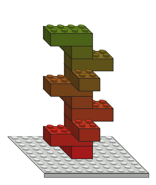 | 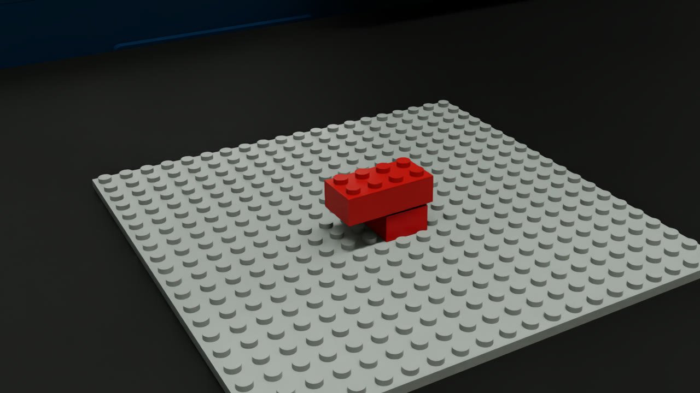 |

- **Bricks:** 10 (10× 2x4).
- **Layers:** 10.
- **Bricks resting on two or more bricks:** 0.
- **Weakest planned joint:** 4 studs.
- **Builds with:** the controller defaults.
- **Runs at these settings:** 2, 0 completed. Latest: failed (a joint broke), 1/10 connected at the end.
- **Also tried (2 s gripper release):** failed (a joint broke), 1/10 connected at the end.
- **Also tried (0.5 s gripper release):** failed (a joint broke), 3/10 connected at the end.
- **Failure mechanism:** E: the second joint breaks after four breakage-solver non-convergences. See [FAILURES.md](../experiments/ur5e_structures/FAILURES.md#mechanisms).
- **Media:** [video (MP4)](media/spiral_tower.mp4) · [config](../experiments/ur5e_structures/spiral_tower.json)

### L corner

Two posts joined by a corner brick.

| Design | Simulation |
|---|---|
| 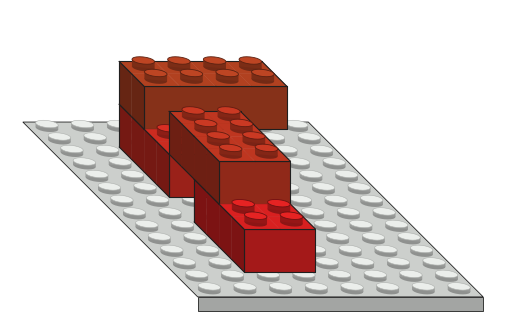 | 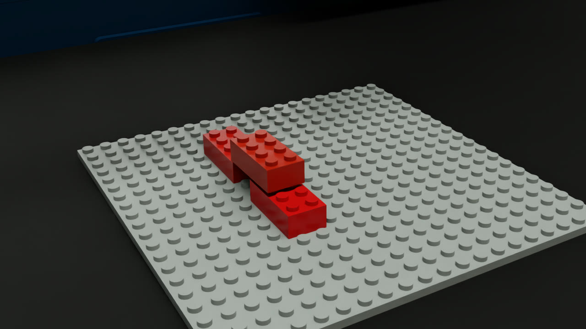 |

- **Bricks:** 4 (4× 2x4).
- **Layers:** 2.
- **Bricks resting on two or more bricks:** 0.
- **Weakest planned joint:** 4 studs.
- **Builds with:** 0.5 s gripper release.
- **Runs at these settings:** 2, 2 completed. Latest: completed, 4/4 connected.
- **Also tried (1 s gripper release (controller default)) ×2:** failed (a joint broke), 2/4 connected at the end.
- **Also tried (2 s gripper release):** failed (a joint broke), 2/4 connected at the end.
- **Also tried (1 s gripper release (controller default), ease off 0.5 mm before letting go):** failed (a joint broke), 2/4 connected at the end.
- **Failure mechanism:** A: press load through a 4-stud joint. See [FAILURES.md](../experiments/ur5e_structures/FAILURES.md#mechanisms).
- **Media:** [video (MP4)](media/l_corner.mp4) · [config](../experiments/ur5e_structures/l_corner.json)

### Offset tower

Six 2x4 bricks alternating direction, each shifted by a stud.

| Design | Simulation |
|---|---|
| 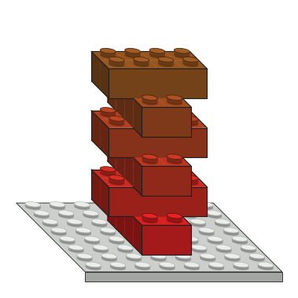 |  |

- **Bricks:** 6 (6× 2x4).
- **Layers:** 6.
- **Bricks resting on two or more bricks:** 0.
- **Weakest planned joint:** 4 studs.
- **Builds with:** ease off 0.5 mm before letting go.
- **Runs at these settings:** 2, 2 completed. Latest: completed, 6/6 connected.
- **Also tried (no easing off (controller default)) ×2:** failed (a joint broke), 5/6 connected at the end.
- **Also tried (2 s gripper release, no easing off (controller default)):** failed (a joint broke), 2/6 connected at the end.
- **Also tried (0.5 s gripper release, no easing off (controller default)):** failed (a joint broke), 1/6 connected at the end.
- **Failure mechanism:** B: release load on a 4-stud joint. See [FAILURES.md](../experiments/ur5e_structures/FAILURES.md#mechanisms).
- **Media:** [video (MP4)](media/tower.mp4) · [config](../experiments/ur5e_structures/tower.json)

## Break tests (failures on purpose)

Each pushes one failure mechanism, some with a matched control.

### Cantilever

A 2x6 rests by one end on a 2x2 column, with a 2x2 pressed onto its free tip.

| Design | Simulation |
|---|---|
| 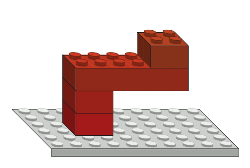 | 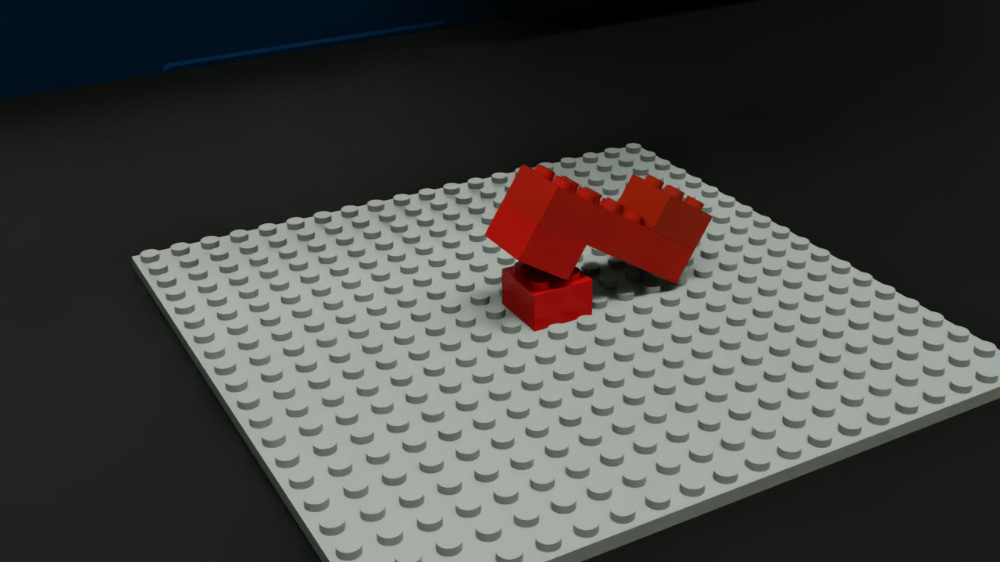 |

- **Bricks:** 4 (3× 2x2, 1× 2x6).
- **Layers:** 4.
- **Bricks resting on two or more bricks:** 0.
- **Weakest planned joint:** 4 studs.
- **Builds with:** the controller defaults.
- **Runs at these settings:** 3, 0 completed. Latest: failed (a joint broke), 3/4 connected at the end.
- **Also tried (2 s gripper release):** failed (a joint broke), 3/4 connected at the end.
- **Also tried (ease off 0.5 mm before letting go):** failed (a joint broke), 3/4 connected at the end.
- **Also tried (0.5 s gripper release):** failed (a joint broke), 3/4 connected at the end.
- **Also tried (0.5 s gripper release, ease off 0.5 mm before letting go):** failed (a joint broke), 1/4 connected at the end.
- **Failure mechanism:** A: press on the overhang. See [FAILURES.md](../experiments/ur5e_structures/FAILURES.md#mechanisms).
- **Media:** [video (MP4)](media/cantilever_failure.mp4) · [GIF](media/cantilever_failure.gif) · [config](../experiments/ur5e_structures/cantilever.json)

### Cantilever, two bricks at the tip

Two 2x2 bricks pressed onto the free tip of the cantilever.

| Design | Simulation |
|---|---|
| 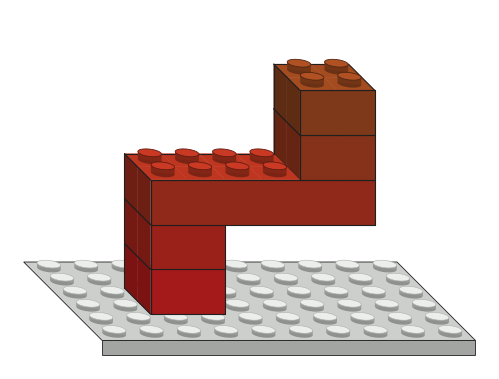 | 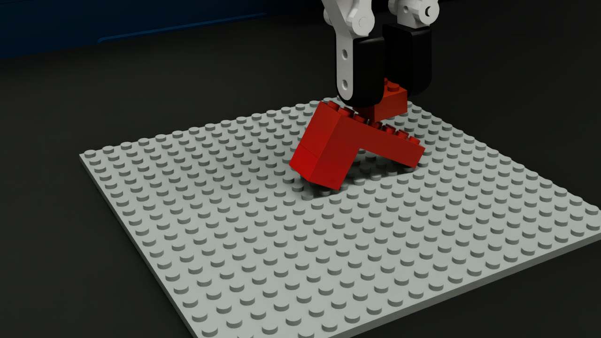 |

- **Bricks:** 5 (4× 2x2, 1× 2x6).
- **Layers:** 5.
- **Bricks resting on two or more bricks:** 0.
- **Weakest planned joint:** 4 studs.
- **Builds with:** the controller defaults.
- **Runs at these settings:** 2, 0 completed. Latest: failed (a brick did not seat), 2/5 connected at the end.
- **Also tried (2 s gripper release):** failed (a joint broke), 3/5 connected at the end.
- **Also tried (ease off 0.5 mm before letting go):** failed (a joint broke), 2/5 connected at the end.
- **Also tried (0.5 s gripper release):** failed (a joint broke), 1/5 connected at the end.
- **Failure mechanism:** A: the press pries the column's base joint off before the brick seats. See [FAILURES.md](../experiments/ur5e_structures/FAILURES.md#mechanisms).
- **Media:** [video (MP4)](media/cantilever_tip2.mp4) · [config](../experiments/ur5e_structures/cantilever_tip2.json)

### Cantilever, two bricks over the support (control)

The same two bricks pressed over the support instead of the tip.

| Design | Simulation |
|---|---|
| 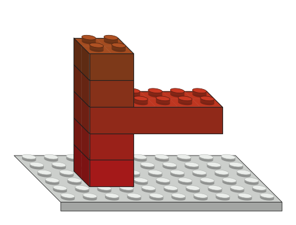 | 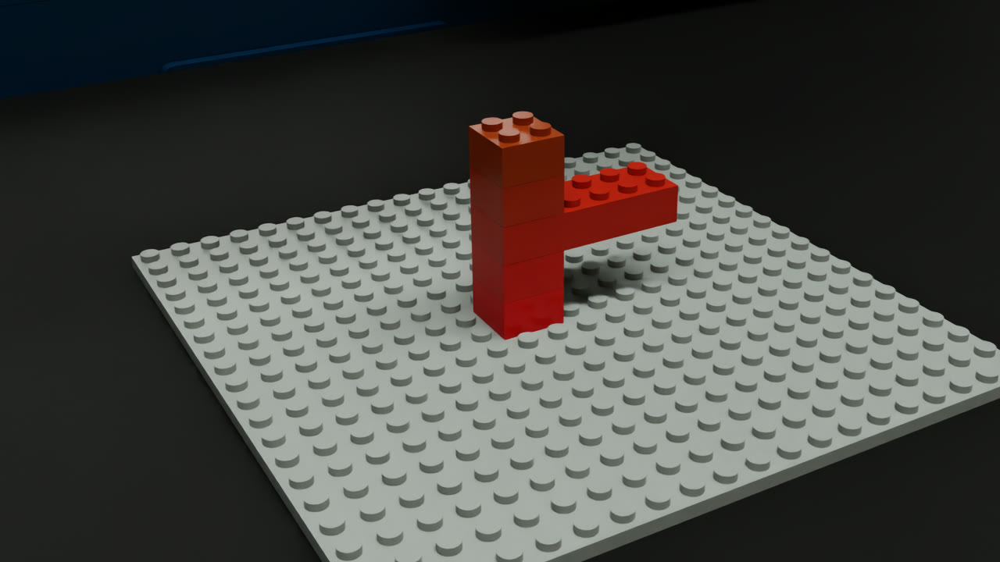 |

- **Bricks:** 5 (4× 2x2, 1× 2x6).
- **Layers:** 5.
- **Bricks resting on two or more bricks:** 0.
- **Weakest planned joint:** 4 studs.
- **Builds with:** the controller defaults.
- **Runs at these settings:** 2, 2 completed. Latest: completed, 5/5 connected.
- **Media:** [video (MP4)](media/cantilever_root2.mp4) · [config](../experiments/ur5e_structures/cantilever_root2.json)

### Leaning ladder

Eight 4x2 bricks, each shifted one stud: the lean grows with every layer.

| Design | Simulation |
|---|---|
| 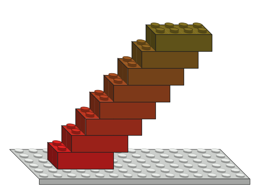 | 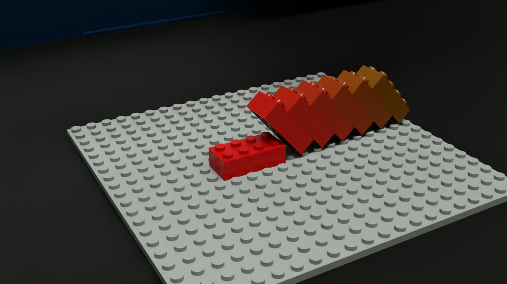 |

- **Bricks:** 8 (8× 2x4).
- **Layers:** 8.
- **Bricks resting on two or more bricks:** 0.
- **Weakest planned joint:** 6 studs.
- **Builds with:** 0.5 s gripper release.
- **Runs at these settings:** 2, 2 completed. Latest: completed, 8/8 connected.
- **Also tried (1 s gripper release (controller default)) ×2:** failed (a joint broke), 6/8 connected at the end.
- **Also tried (2 s gripper release):** failed (a joint broke), 5/8 connected at the end.
- **Also tried (1 s gripper release (controller default), ease off 0.5 mm before letting go):** failed (a joint broke), 6/8 connected at the end.
- **Failure mechanism:** B: growing overturning moment on the low joints. See [FAILURES.md](../experiments/ur5e_structures/FAILURES.md#mechanisms).
- **Media:** [video (MP4)](media/lean_ladder.mp4) · [config](../experiments/ur5e_structures/lean_ladder.json)

### 2x2 tower

Ten 2x2 bricks: every joint has only 4 studs.

| Design | Simulation |
|---|---|
| 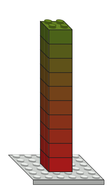 | 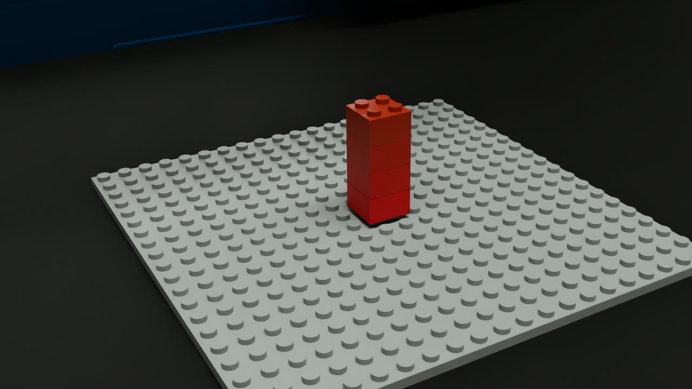 |

- **Bricks:** 10 (10× 2x2).
- **Layers:** 10.
- **Bricks resting on two or more bricks:** 0.
- **Weakest planned joint:** 4 studs.
- **Builds with:** the controller defaults.
- **Runs at these settings:** 2, 0 completed. Latest: failed (a joint broke), 3/10 connected at the end.
- **Also tried (2 s gripper release):** failed (a joint broke), 3/10 connected at the end.
- **Also tried (ease off 0.5 mm before letting go):** failed (a joint broke), 3/10 connected at the end.
- **Also tried (0.5 s gripper release):** failed (a joint broke), 2/10 connected at the end.
- **Also tried (0.5 s gripper release, ease off 0.5 mm before letting go):** failed (a brick slipped from the grasp), 3/10 connected at the end.
- **Failure mechanism:** B: the base joint breaks transiently on each release, then for good. See [FAILURES.md](../experiments/ur5e_structures/FAILURES.md#mechanisms).
- **Media:** [video (MP4)](media/tower_2x2.mp4) · [config](../experiments/ur5e_structures/tower_2x2.json)

### Lean 6

Six 2x4 bricks, each shifted 2 studs (4-stud joints).

| Design | Simulation |
|---|---|
| 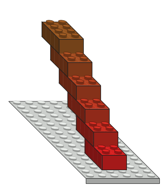 | 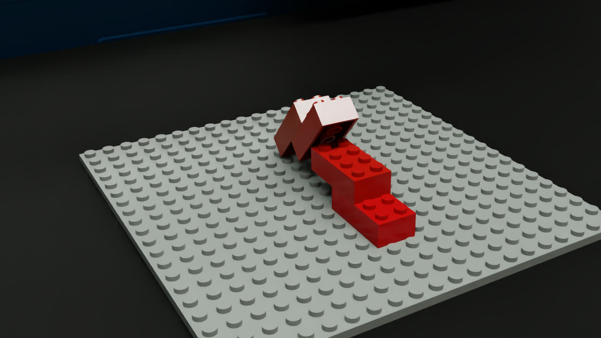 |

- **Bricks:** 6 (6× 2x4).
- **Layers:** 6.
- **Bricks resting on two or more bricks:** 0.
- **Weakest planned joint:** 4 studs.
- **Builds with:** the controller defaults.
- **Runs at these settings:** 2, 0 completed. Latest: failed (a joint broke), 3/6 connected at the end.
- **Also tried (2 s gripper release):** failed (a joint broke), 2/6 connected at the end.
- **Also tried (ease off 0.5 mm before letting go):** failed (a joint broke), 4/6 connected at the end.
- **Also tried (0.5 s gripper release):** failed (a joint broke), 2/6 connected at the end.
- **Also tried (0.5 s gripper release, ease off 0.5 mm before letting go):** failed (a joint broke), 4/6 connected at the end.
- **Failure mechanism:** B: release load on a 4-stud joint. See [FAILURES.md](../experiments/ur5e_structures/FAILURES.md#mechanisms).
- **Media:** [video (MP4)](media/lean_6.mp4) · [config](../experiments/ur5e_structures/lean_6.json)

### Zigzag 6

Six 2x4 bricks shifted +2 and -2 studs in turn.

| Design | Simulation |
|---|---|
| 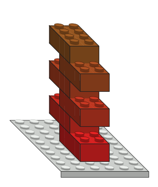 | 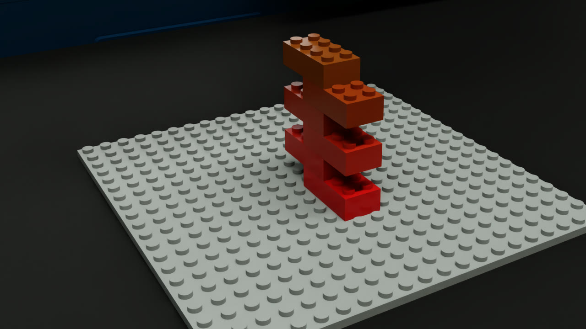 |

- **Bricks:** 6 (6× 2x4).
- **Layers:** 6.
- **Bricks resting on two or more bricks:** 0.
- **Weakest planned joint:** 4 studs.
- **Builds with:** 0.5 s gripper release.
- **Runs at these settings:** 2, 2 completed. Latest: completed, 6/6 connected.
- **Also tried (1 s gripper release (controller default)) ×2:** failed (a joint broke), 3/6 connected at the end.
- **Also tried (2 s gripper release):** failed (a joint broke), 5/6 connected at the end.
- **Also tried (1 s gripper release (controller default), ease off 0.5 mm before letting go):** failed (a joint broke), 2/6 connected at the end.
- **Failure mechanism:** A: press load through a 4-stud joint. See [FAILURES.md](../experiments/ur5e_structures/FAILURES.md#mechanisms).
- **Media:** [video (MP4)](media/zigzag_6.mp4) · [config](../experiments/ur5e_structures/zigzag_6.json)

### Column of ten

Ten aligned 2x4 bricks: the load on the base grows with height.

| Design | Simulation |
|---|---|
| 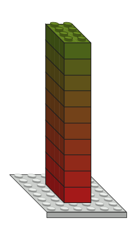 | 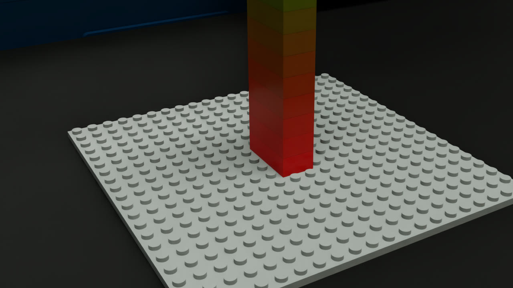 |

- **Bricks:** 10 (10× 2x4).
- **Layers:** 10.
- **Bricks resting on two or more bricks:** 0.
- **Weakest planned joint:** 8 studs.
- **Builds with:** 0.5 s gripper release.
- **Runs at these settings:** 2, 2 completed. Latest: completed, 10/10 connected.
- **Also tried (1 s gripper release (controller default)) ×2:** failed (a joint broke), 9/10 connected at the end.
- **Also tried (2 s gripper release):** failed (a joint broke), 2/10 connected at the end.
- **Also tried (1 s gripper release (controller default), ease off 0.5 mm before letting go):** failed (a joint broke), 6/10 connected at the end.
- **Failure mechanism:** B: release load accumulated over ten layers. See [FAILURES.md](../experiments/ur5e_structures/FAILURES.md#mechanisms).
- **Media:** [video (MP4)](media/column_10.mp4) · [config](../experiments/ur5e_structures/column_10.json)

### Column, turned 90 degrees

The 4-brick column with every brick laid along x: the same 8-stud joints, gripped with the wrist turned 90 degrees. It is a control for the house wall.

| Design | Simulation |
|---|---|
| 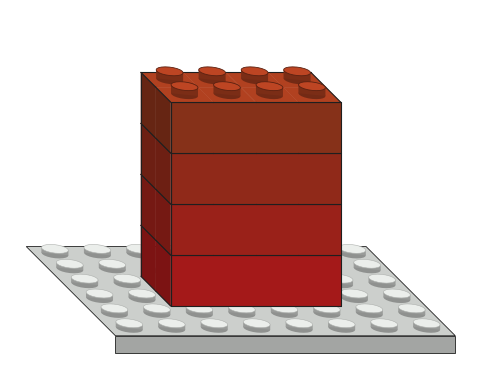 | 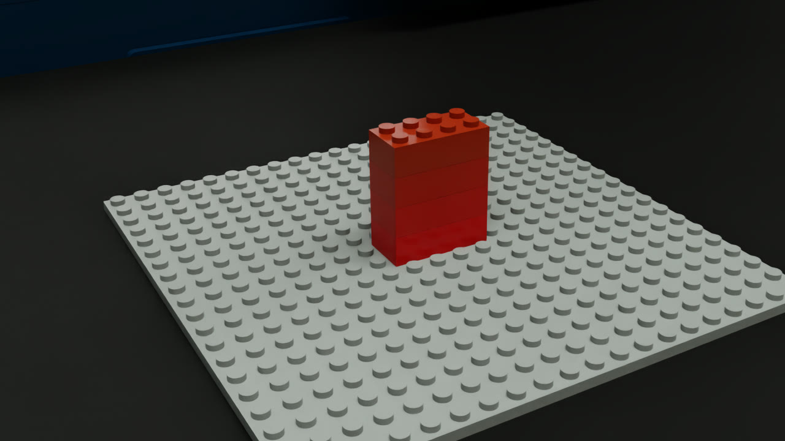 |

- **Bricks:** 4 (4× 2x4).
- **Layers:** 4.
- **Bricks resting on two or more bricks:** 0.
- **Weakest planned joint:** 8 studs.
- **Builds with:** the controller defaults.
- **Runs at these settings:** 2, 2 completed. Latest: completed, 4/4 connected.
- **Media:** [video (MP4)](media/column_turned.mp4) · [config](../experiments/ur5e_structures/column_turned.json)

## Basics

Simple builds used to check the controller and the breakage model.

### Single brick

One 2x4 on the baseplate.

| Design | Simulation |
|---|---|
|  |  |

- **Bricks:** 1 (1× 2x4).
- **Layers:** 1.
- **Bricks resting on two or more bricks:** 0.
- **Weakest planned joint:** 8 studs.
- **Builds with:** the controller defaults.
- **Runs at these settings:** 2, 2 completed. Latest: completed, 1/1 connected.
- **Media:** [video (MP4)](media/single.mp4) · [config](../experiments/ur5e_structures/single.json)

### Column

Four aligned 2x4 bricks (8-stud joints). It is also the press-force sweep: it holds at 1 and 2 N and loses its base joint at 3 and 5 N.

| Design | Simulation |
|---|---|
|  |  |

- **Bricks:** 4 (4× 2x4).
- **Layers:** 4.
- **Bricks resting on two or more bricks:** 0.
- **Weakest planned joint:** 8 studs.
- **Builds with:** the controller defaults.
- **Runs at these settings:** 3, 3 completed. Latest: completed, 4/4 connected.
- **Also tried (2 N press):** completed, 4/4 connected.
- **Also tried (3 N press):** failed (a joint broke), 1/4 connected at the end.
- **Also tried (5 N press):** failed (a joint broke), 2/4 connected at the end.
- **Media:** [video (MP4)](media/column.mp4) · [config](../experiments/ur5e_structures/column.json)

### Stairs

A staircase of 2x4, 2x2 and 2x6 bricks.

| Design | Simulation |
|---|---|
|  |  |

- **Bricks:** 8 (8× 2x4).
- **Layers:** 3.
- **Bricks resting on two or more bricks:** 0.
- **Weakest planned joint:** 4 studs.
- **Builds with:** the controller defaults.
- **Runs at these settings:** 2, 2 completed. Latest: completed, 8/8 connected.
- **Media:** [video (MP4)](media/stairs.mp4) · [config](../experiments/ur5e_structures/stairs.json)
