# Structure catalog (simulation)

Generated by `experiments/ur5e_structures/catalog.py`; do not edit by hand.

Every structure the UR5e builds in Isaac Sim 6.2. Each entry shows:
- the design, drawn from the config;
- the simulated build at the end of its latest captured run, if any;
- the bricks and joints;
- the latest simulation result at the default settings.

These are simulation results judged by simulator ground truth. Nothing here
ran on hardware. Per-run details are in the
[sweep summaries](../experiments/ur5e_structures/sweeps/README.md), and
the failure mechanisms are explained in
[FAILURES.md](../experiments/ur5e_structures/FAILURES.md).

| Structure | Section | Bricks | Latest simulation |
|---|---|---|---|
| [Dog](#dog) | Showcase builds | 10 | completed |
| [Arch bridge](#bridge) | Showcase builds | 7 | completed |
| [House](#house) | Showcase builds | 8 | failed (see note) |
| [Log cabin](#log_cabin) | Showcase builds | 8 | completed |
| [Human](#human) | Figures | 8 | completed |
| [Robot](#robot) | Figures | 5 | completed |
| [Sitting cat](#cat) | Figures | 5 | completed |
| [Giraffe](#giraffe) | Figures | 6 | failed |
| [Tree](#tree) | Figures | 6 | failed |
| [Duck](#duck) | Figures | 4 | failed |
| [Table](#table) | Complex builds that failed | 10 | failed |
| [Mixed tower](#mixed_tower) | Complex builds that failed | 8 | failed |
| [Cross-bonded tower](#cross_tower) | Complex builds that failed | 10 | failed |
| [Spiral tower](#spiral_tower) | Complex builds that failed | 10 | failed |
| [L corner](#l_corner) | Complex builds that failed | 4 | failed |
| [Offset tower](#tower) | Complex builds that failed | 6 | failed |
| [Cantilever](#cantilever) | Break tests (failures on purpose) | 4 | failed |
| [Cantilever, two bricks at the tip](#cantilever_tip2) | Break tests (failures on purpose) | 5 | failed |
| [Cantilever, two bricks over the support (control)](#cantilever_root2) | Break tests (failures on purpose) | 5 | completed |
| [Leaning ladder](#lean_ladder) | Break tests (failures on purpose) | 8 | failed |
| [2x2 tower](#tower_2x2) | Break tests (failures on purpose) | 10 | failed |
| [Lean 6](#lean_6) | Break tests (failures on purpose) | 6 | failed |
| [Zigzag 6](#zigzag_6) | Break tests (failures on purpose) | 6 | failed |
| [Column of ten](#column_10) | Break tests (failures on purpose) | 10 | failed |
| [Column, turned 90 degrees](#column_turned) | Break tests (failures on purpose) | 4 | completed |
| [Single brick](#single) | Basics | 1 | completed |
| [Column](#column) | Basics | 4 | completed |
| [Stairs](#stairs) | Basics | 8 | completed |

## Showcase builds

Recognisable structures that need distinctive steps.

### Dog

Ten bricks: four legs, a wide body bridging them, a neck, head and tail.

| Design | Simulation |
|---|---|
|  |  |

- **Bricks:** 10 (7× 2x4, 1× 2x8, 2× 4x6).
- **Layers:** 5.
- **Bricks resting on two or more bricks:** 3.
- **Weakest planned joint:** 4 studs.
- **Latest simulation (breakage on, 1 N press):** completed, 10/10 connected.
- **Simulation runs:** 13 (10 completed).
- **Media:** [video (MP4)](media/dog_breakage_on.mp4) · [GIF](media/dog_breakage_on.gif) · [config](../experiments/ur5e_dog/dog.json)

### Arch bridge

A corbel arch: each pier steps one stud inward, then a 2x10 deck closes the arch by landing on both piers. Two parapets finish the deck.

| Design | Simulation |
|---|---|
|  |  |

- **Bricks:** 7 (1× 2x10, 4× 2x4, 2× 2x6).
- **Layers:** 4.
- **Bricks resting on two or more bricks:** 1.
- **Weakest planned joint:** 6 studs.
- **Latest simulation (breakage on, 1 N press):** completed, 7/7 connected.
- **Simulation runs:** 1 (1 completed).
- **Media:** [video (MP4)](media/bridge.mp4) · [GIF](media/bridge.gif) · [config](../experiments/ur5e_structures/bridge.json)

### House

A facade with a doorway. Two walls stand two courses high, a 2x10 lintel spans the door and lands on both walls, and a stepped gable roof and a chimney finish it.

| Design | Simulation |
|---|---|
|  |  |

- **Bricks:** 8 (1× 2x10, 1× 2x2, 5× 2x4, 1× 2x8).
- **Layers:** 6.
- **Bricks resting on two or more bricks:** 1.
- **Weakest planned joint:** 4 studs.
- **Latest simulation (breakage on, 1 N press):** failed, 2/8 connected at the end.
- **Simulation runs:** 3 (1 completed).
- **Note:** At the default 1 s gripper release, the first wall joint (8 studs) breaks during a release with no visible motion. With a 2 s release the house completes; the picture and video are that run.
- **Failure mechanism:** B: release load on an 8-stud wall joint at the default 1 s release. See [FAILURES.md](../experiments/ur5e_structures/FAILURES.md#mechanisms).
- **Media:** [video (MP4)](media/house.mp4) · [config](../experiments/ur5e_structures/house.json)

### Log cabin

Courses alternate direction, and every brick above the first interlocks two corners below. It is planned on one corner and lands on both.

| Design | Simulation |
|---|---|
|  |  |

- **Bricks:** 8 (8× 2x8).
- **Layers:** 4.
- **Bricks resting on two or more bricks:** 6.
- **Weakest planned joint:** 4 studs.
- **Latest simulation (breakage on, 1 N press):** completed, 8/8 connected.
- **Simulation runs:** 1 (1 completed).
- **Media:** [video (MP4)](media/log_cabin.mp4) · [config](../experiments/ur5e_structures/log_cabin.json)

## Figures

Small animals and characters, one or two bricks a layer.

### Human

Two legs two bricks high, hips, torso, shoulders and a head.

| Design | Simulation |
|---|---|
| 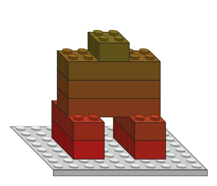 | 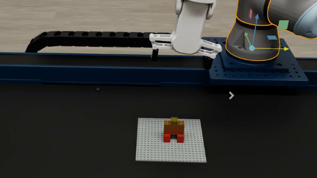 |

- **Bricks:** 8 (1× 2x2, 4× 2x4, 3× 2x6).
- **Layers:** 6.
- **Bricks resting on two or more bricks:** 1.
- **Weakest planned joint:** 4 studs.
- **Latest simulation (breakage on, 1 N press):** completed, 8/8 connected.
- **Simulation runs:** 15 (9 completed).
- **Media:** [video (MP4)](media/human_breakage_on.mp4) · [GIF](media/human_breakage_on.gif) · [config](../experiments/ur5e_structures/human.json)

### Robot

Wide feet, a body across them, shoulders, a head and a hat.

| Design | Simulation |
|---|---|
| 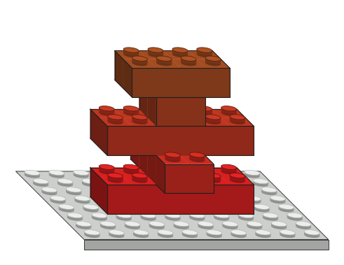 | 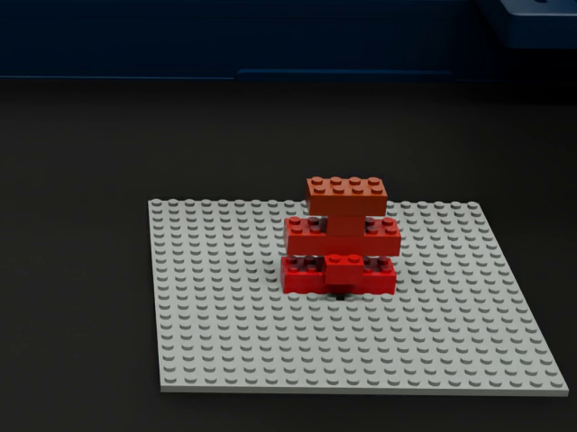 |

- **Bricks:** 5 (1× 2x2, 2× 2x4, 2× 2x6).
- **Layers:** 5.
- **Bricks resting on two or more bricks:** 0.
- **Weakest planned joint:** 4 studs.
- **Latest simulation (breakage on, 1 N press):** completed, 5/5 connected.
- **Simulation runs:** 1 (1 completed).
- **Media:** [video (MP4)](media/robot.mp4) · [config](../experiments/ur5e_structures/robot.json)

### Sitting cat

A two-high body, chest, head and an ear.

| Design | Simulation |
|---|---|
| 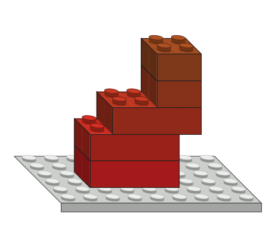 | 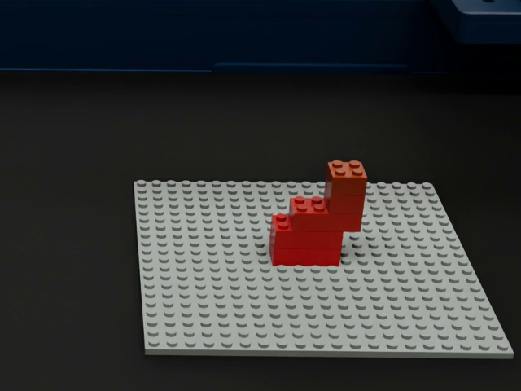 |

- **Bricks:** 5 (2× 2x2, 3× 2x4).
- **Layers:** 5.
- **Bricks resting on two or more bricks:** 0.
- **Weakest planned joint:** 4 studs.
- **Latest simulation (breakage on, 1 N press):** completed, 5/5 connected.
- **Simulation runs:** 1 (1 completed).
- **Media:** [video (MP4)](media/cat.mp4) · [config](../experiments/ur5e_structures/cat.json)

### Giraffe

A two-high leg, a body reaching forward, a two-high neck and a head with a snout.

| Design | Simulation |
|---|---|
| 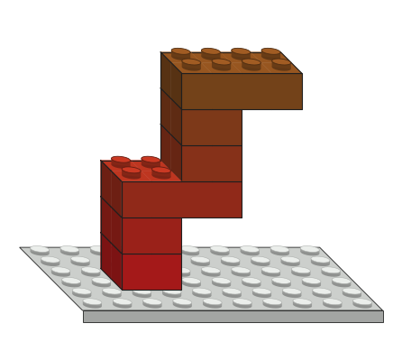 | 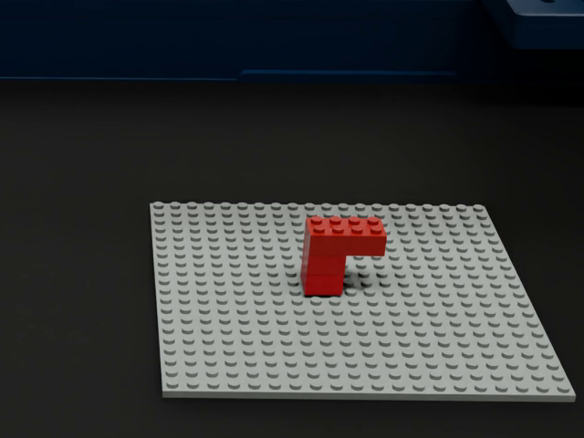 |

- **Bricks:** 6 (4× 2x2, 2× 2x4).
- **Layers:** 6.
- **Bricks resting on two or more bricks:** 0.
- **Weakest planned joint:** 4 studs.
- **Latest simulation (breakage on, 1 N press):** failed, 2/6 connected at the end.
- **Simulation runs:** 1 (0 completed).
- **Failure mechanism:** A: the neck is pressed onto the far end of the body and pries the 4-stud base joint. See [FAILURES.md](../experiments/ur5e_structures/FAILURES.md#mechanisms).
- **Media:** [video (MP4)](media/giraffe.mp4) · [config](../experiments/ur5e_structures/giraffe.json)

### Tree

A three-high 2x2 trunk under a crown of 2x6, 4x2 and 2x2 bricks.

| Design | Simulation |
|---|---|
|  | 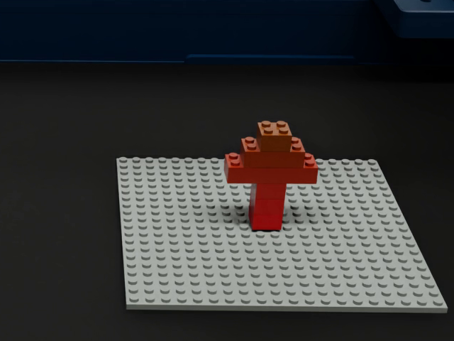 |

- **Bricks:** 6 (4× 2x2, 1× 2x4, 1× 2x6).
- **Layers:** 6.
- **Bricks resting on two or more bricks:** 0.
- **Weakest planned joint:** 4 studs.
- **Latest simulation (breakage on, 1 N press):** failed, 5/6 connected at the end.
- **Simulation runs:** 1 (0 completed).
- **Failure mechanism:** B: the trunk's 4-stud base joint breaks on the releases, transiently, then for good. See [FAILURES.md](../experiments/ur5e_structures/FAILURES.md#mechanisms).
- **Media:** [video (MP4)](media/tree.mp4) · [config](../experiments/ur5e_structures/tree.json)

### Duck

A foot, a long body, a neck at the front and a head with a beak.

| Design |
|---|
| 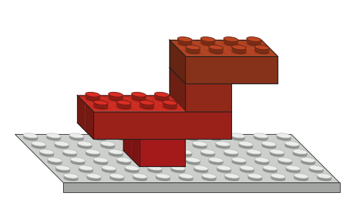 |

- **Bricks:** 4 (2× 2x2, 1× 2x4, 1× 2x6).
- **Layers:** 4.
- **Bricks resting on two or more bricks:** 0.
- **Weakest planned joint:** 4 studs.
- **Latest simulation (breakage on, 1 N press):** failed, 2/4 connected at the end.
- **Simulation runs:** 1 (0 completed).
- **Failure mechanism:** F: the 2x2 neck slipped out of the grasp during transfer. See [FAILURES.md](../experiments/ur5e_structures/FAILURES.md#mechanisms).
- **Media:** [config](../experiments/ur5e_structures/duck.json)

## Complex builds that failed

Attempts at harder structures. Each failure is a documented test case.

### Table

Four 2x2 legs two bricks high under two 2x6 tops.

| Design |
|---|
|  |

- **Bricks:** 10 (8× 2x2, 2× 2x6).
- **Layers:** 3.
- **Bricks resting on two or more bricks:** 2.
- **Weakest planned joint:** 4 studs.
- **Latest simulation (breakage on, 1 N press):** failed, 4/10 connected at the end.
- **Simulation runs:** 5 (1 completed).
- **Failure mechanism:** C: legs 2 studs apart leave no room for the RG2 fingers to let go. See [FAILURES.md](../experiments/ur5e_structures/FAILURES.md#mechanisms).
- **Media:** [config](../experiments/ur5e_structures/table.json)

### Mixed tower

Eight bricks of three sizes stacked with offsets.

| Design |
|---|
|  |

- **Bricks:** 8 (3× 2x2, 3× 2x4, 2× 2x6).
- **Layers:** 8.
- **Bricks resting on two or more bricks:** 0.
- **Weakest planned joint:** 4 studs.
- **Latest simulation (breakage on, 1 N press):** failed, 5/8 connected at the end.
- **Simulation runs:** 4 (0 completed).
- **Failure mechanism:** D: a brick stops on the studs and does not seat. See [FAILURES.md](../experiments/ur5e_structures/FAILURES.md#mechanisms).
- **Media:** [config](../experiments/ur5e_structures/mixed_tower.json)

### Cross-bonded tower

Ten 2x4 bricks alternating +90 and -90 degrees.

| Design |
|---|
|  |

- **Bricks:** 10 (10× 2x4).
- **Layers:** 10.
- **Bricks resting on two or more bricks:** 0.
- **Weakest planned joint:** 4 studs.
- **Latest simulation (breakage on, 1 N press):** failed, 1/10 connected at the end.
- **Simulation runs:** 4 (1 completed).
- **Failure mechanism:** E: the second joint breaks after four breakage-solver non-convergences. See [FAILURES.md](../experiments/ur5e_structures/FAILURES.md#mechanisms).
- **Media:** [config](../experiments/ur5e_structures/cross_tower.json)

### Spiral tower

Ten 2x4 bricks, each a quarter turn from the one below.

| Design |
|---|
|  |

- **Bricks:** 10 (10× 2x4).
- **Layers:** 10.
- **Bricks resting on two or more bricks:** 0.
- **Weakest planned joint:** 4 studs.
- **Latest simulation (breakage on, 1 N press):** failed, 1/10 connected at the end.
- **Simulation runs:** 4 (1 completed).
- **Failure mechanism:** E: the second joint breaks after four breakage-solver non-convergences. See [FAILURES.md](../experiments/ur5e_structures/FAILURES.md#mechanisms).
- **Media:** [config](../experiments/ur5e_structures/spiral_tower.json)

### L corner

Two posts joined by a corner brick.

| Design |
|---|
|  |

- **Bricks:** 4 (4× 2x4).
- **Layers:** 2.
- **Bricks resting on two or more bricks:** 0.
- **Weakest planned joint:** 4 studs.
- **Latest simulation (breakage on, 1 N press):** failed, 2/4 connected at the end.
- **Simulation runs:** 5 (2 completed).
- **Failure mechanism:** A: press load through a 4-stud joint. See [FAILURES.md](../experiments/ur5e_structures/FAILURES.md#mechanisms).
- **Media:** [config](../experiments/ur5e_structures/l_corner.json)

### Offset tower

Six 2x4 bricks alternating direction, each shifted by a stud.

| Design |
|---|
|  |

- **Bricks:** 6 (6× 2x4).
- **Layers:** 6.
- **Bricks resting on two or more bricks:** 0.
- **Weakest planned joint:** 4 studs.
- **Latest simulation (breakage on, 1 N press):** failed, 5/6 connected at the end.
- **Simulation runs:** 9 (2 completed).
- **Failure mechanism:** B: release load on a 4-stud joint. See [FAILURES.md](../experiments/ur5e_structures/FAILURES.md#mechanisms).
- **Media:** [config](../experiments/ur5e_structures/tower.json)

## Break tests (failures on purpose)

Each pushes one failure mechanism, some with a matched control.

### Cantilever

A 2x6 rests by one end on a 2x2 column, with a 2x2 pressed onto its free tip.

| Design | Simulation |
|---|---|
|  | 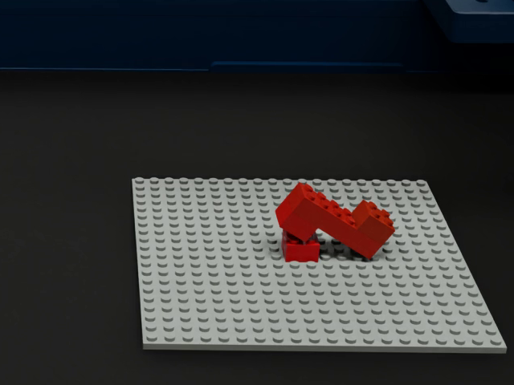 |

- **Bricks:** 4 (3× 2x2, 1× 2x6).
- **Layers:** 4.
- **Bricks resting on two or more bricks:** 0.
- **Weakest planned joint:** 4 studs.
- **Latest simulation (breakage on, 1 N press):** failed, 3/4 connected at the end.
- **Simulation runs:** 12 (2 completed).
- **Failure mechanism:** A: press on the overhang. See [FAILURES.md](../experiments/ur5e_structures/FAILURES.md#mechanisms).
- **Media:** [video (MP4)](media/cantilever_failure.mp4) · [GIF](media/cantilever_failure.gif) · [config](../experiments/ur5e_structures/cantilever.json)

### Cantilever, two bricks at the tip

Two 2x2 bricks pressed onto the free tip of the cantilever.

| Design | Simulation |
|---|---|
|  | 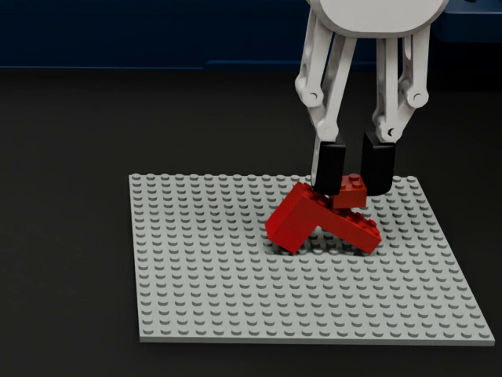 |

- **Bricks:** 5 (4× 2x2, 1× 2x6).
- **Layers:** 5.
- **Bricks resting on two or more bricks:** 0.
- **Weakest planned joint:** 4 studs.
- **Latest simulation (breakage on, 1 N press):** failed, 2/5 connected at the end.
- **Simulation runs:** 1 (0 completed).
- **Failure mechanism:** A: the press pries the column's base joint off before the brick seats. See [FAILURES.md](../experiments/ur5e_structures/FAILURES.md#mechanisms).
- **Media:** [video (MP4)](media/cantilever_tip2.mp4) · [config](../experiments/ur5e_structures/cantilever_tip2.json)

### Cantilever, two bricks over the support (control)

The same two bricks pressed over the support instead of the tip.

| Design | Simulation |
|---|---|
|  | 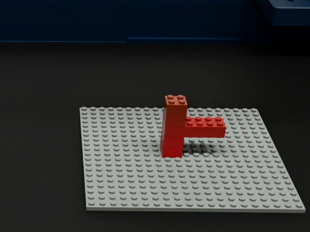 |

- **Bricks:** 5 (4× 2x2, 1× 2x6).
- **Layers:** 5.
- **Bricks resting on two or more bricks:** 0.
- **Weakest planned joint:** 4 studs.
- **Latest simulation (breakage on, 1 N press):** completed, 5/5 connected.
- **Simulation runs:** 1 (1 completed).
- **Media:** [video (MP4)](media/cantilever_root2.mp4) · [config](../experiments/ur5e_structures/cantilever_root2.json)

### Leaning ladder

Eight 4x2 bricks, each shifted one stud: the lean grows with every layer.

| Design | Simulation |
|---|---|
|  | 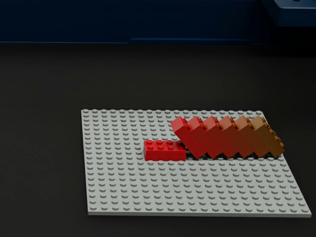 |

- **Bricks:** 8 (8× 2x4).
- **Layers:** 8.
- **Bricks resting on two or more bricks:** 0.
- **Weakest planned joint:** 6 studs.
- **Latest simulation (breakage on, 1 N press):** failed, 6/8 connected at the end.
- **Simulation runs:** 1 (0 completed).
- **Failure mechanism:** B: growing overturning moment on the low joints. See [FAILURES.md](../experiments/ur5e_structures/FAILURES.md#mechanisms).
- **Media:** [video (MP4)](media/lean_ladder.mp4) · [config](../experiments/ur5e_structures/lean_ladder.json)

### 2x2 tower

Ten 2x2 bricks: every joint has only 4 studs.

| Design | Simulation |
|---|---|
|  | 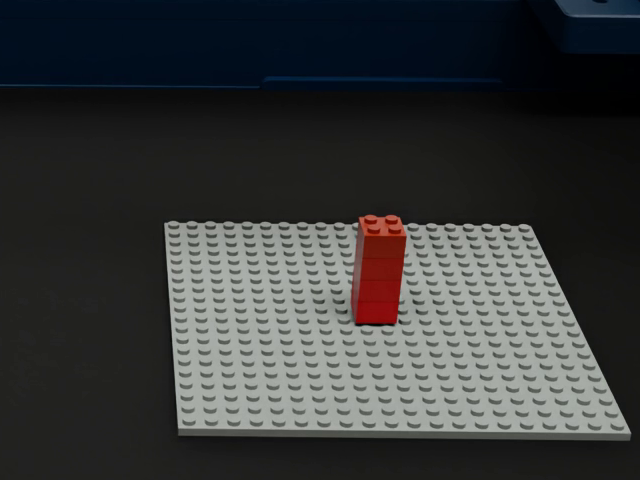 |

- **Bricks:** 10 (10× 2x2).
- **Layers:** 10.
- **Bricks resting on two or more bricks:** 0.
- **Weakest planned joint:** 4 studs.
- **Latest simulation (breakage on, 1 N press):** failed, 3/10 connected at the end.
- **Simulation runs:** 1 (0 completed).
- **Failure mechanism:** B: the base joint breaks transiently on each release, then for good. See [FAILURES.md](../experiments/ur5e_structures/FAILURES.md#mechanisms).
- **Media:** [video (MP4)](media/tower_2x2.mp4) · [config](../experiments/ur5e_structures/tower_2x2.json)

### Lean 6

Six 2x4 bricks, each shifted 2 studs (4-stud joints).

| Design |
|---|
|  |

- **Bricks:** 6 (6× 2x4).
- **Layers:** 6.
- **Bricks resting on two or more bricks:** 0.
- **Weakest planned joint:** 4 studs.
- **Latest simulation (breakage on, 1 N press):** failed, 3/6 connected at the end.
- **Simulation runs:** 5 (1 completed).
- **Failure mechanism:** B: release load on a 4-stud joint. See [FAILURES.md](../experiments/ur5e_structures/FAILURES.md#mechanisms).
- **Media:** [config](../experiments/ur5e_structures/lean_6.json)

### Zigzag 6

Six 2x4 bricks shifted +2 and -2 studs in turn.

| Design |
|---|
|  |

- **Bricks:** 6 (6× 2x4).
- **Layers:** 6.
- **Bricks resting on two or more bricks:** 0.
- **Weakest planned joint:** 4 studs.
- **Latest simulation (breakage on, 1 N press):** failed, 3/6 connected at the end.
- **Simulation runs:** 5 (1 completed).
- **Failure mechanism:** A: press load through a 4-stud joint. See [FAILURES.md](../experiments/ur5e_structures/FAILURES.md#mechanisms).
- **Media:** [config](../experiments/ur5e_structures/zigzag_6.json)

### Column of ten

Ten aligned 2x4 bricks: the load on the base grows with height.

| Design |
|---|
|  |

- **Bricks:** 10 (10× 2x4).
- **Layers:** 10.
- **Bricks resting on two or more bricks:** 0.
- **Weakest planned joint:** 8 studs.
- **Latest simulation (breakage on, 1 N press):** failed, 9/10 connected at the end.
- **Simulation runs:** 4 (0 completed).
- **Failure mechanism:** B: release load accumulated over ten layers. See [FAILURES.md](../experiments/ur5e_structures/FAILURES.md#mechanisms).
- **Media:** [config](../experiments/ur5e_structures/column_10.json)

### Column, turned 90 degrees

The 4-brick column with every brick laid along x: the same 8-stud joints, gripped with the wrist turned 90 degrees. It is a control for the house wall.

| Design |
|---|
|  |

- **Bricks:** 4 (4× 2x4).
- **Layers:** 4.
- **Bricks resting on two or more bricks:** 0.
- **Weakest planned joint:** 8 studs.
- **Latest simulation (breakage on, 1 N press):** completed, 4/4 connected.
- **Simulation runs:** 1 (1 completed).
- **Media:** [config](../experiments/ur5e_structures/column_turned.json)

## Basics

Simple builds used to check the controller and the breakage model.

### Single brick

One 2x4 on the baseplate.

| Design |
|---|
|  |

- **Bricks:** 1 (1× 2x4).
- **Layers:** 1.
- **Bricks resting on two or more bricks:** 0.
- **Weakest planned joint:** 8 studs.
- **Latest simulation (breakage on, 1 N press):** completed, 1/1 connected.
- **Simulation runs:** 6 (6 completed).
- **Media:** [config](../experiments/ur5e_structures/single.json)

### Column

Four aligned 2x4 bricks (8-stud joints). It is also the press-force sweep: it holds at 1 and 2 N and loses its base joint at 3 and 5 N.

| Design |
|---|
|  |

- **Bricks:** 4 (4× 2x4).
- **Layers:** 4.
- **Bricks resting on two or more bricks:** 0.
- **Weakest planned joint:** 8 studs.
- **Latest simulation (breakage on, 1 N press):** completed, 4/4 connected.
- **Simulation runs:** 9 (6 completed).
- **Media:** [config](../experiments/ur5e_structures/column.json)

### Stairs

A staircase of 2x4, 2x2 and 2x6 bricks.

| Design |
|---|
|  |

- **Bricks:** 8 (8× 2x4).
- **Layers:** 3.
- **Bricks resting on two or more bricks:** 0.
- **Weakest planned joint:** 4 studs.
- **Latest simulation (breakage on, 1 N press):** completed, 8/8 connected.
- **Simulation runs:** 6 (1 completed).
- **Media:** [config](../experiments/ur5e_structures/stairs.json)
