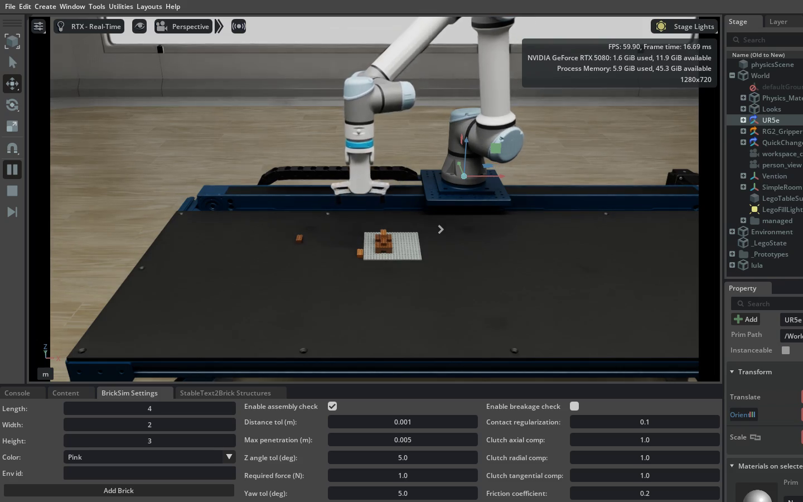
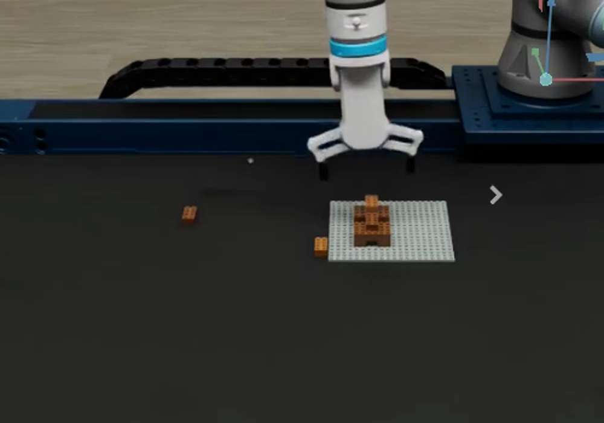
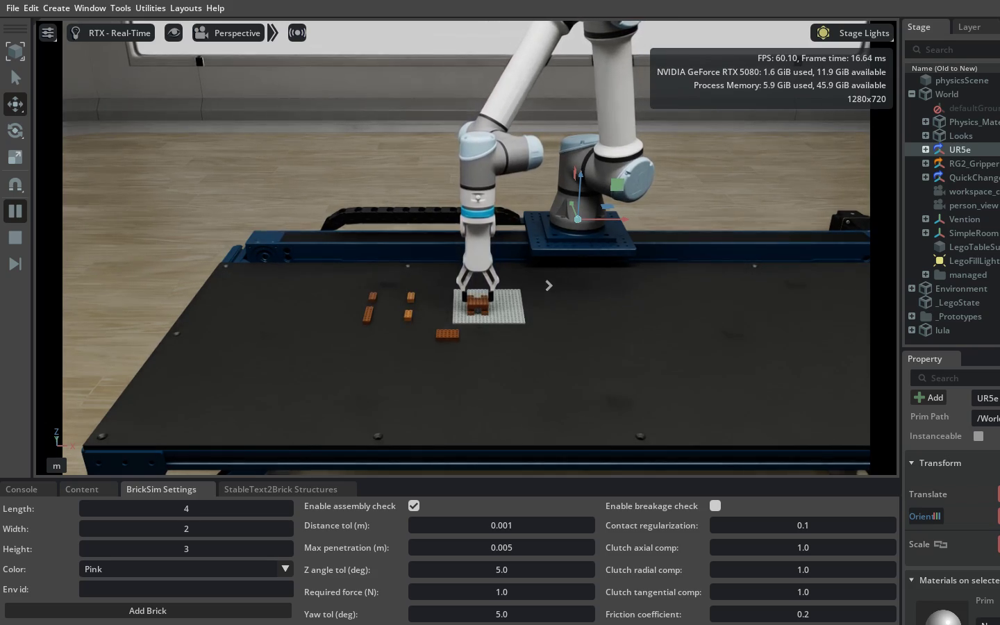
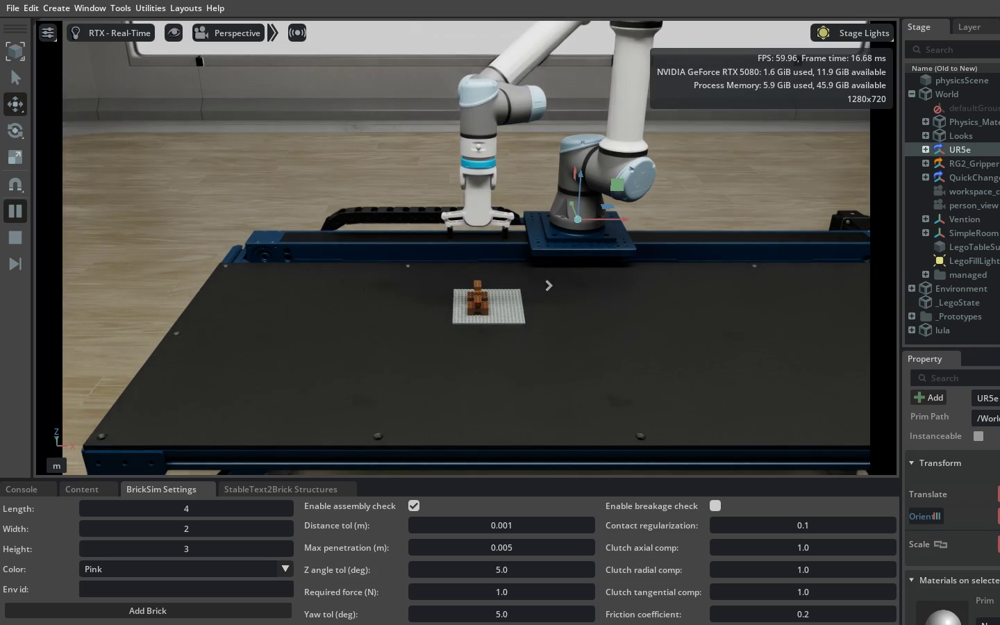
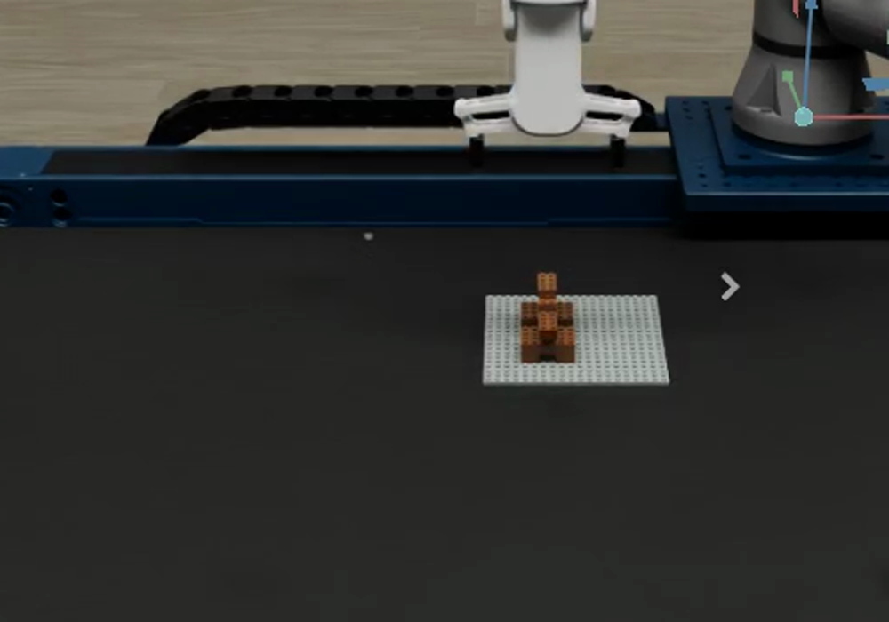

# UR5e assembly controller

Builds any structure config from
[experiments/ur5e_structures/](../ur5e_structures/README.md) with the UR5e and
RG2 gripper on the anchored 20x20 baseplate. Simulation only: nothing here
connects to a robot. Settings, sweeps and reproduction are in
[docs/USAGE.md](../../docs/USAGE.md).

## Run one structure

```bash
OMNI_KIT_ACCEPT_EULA=YES bash experiments/ur5e_assembly/run_loop.sh \
  --attempts 1 --config experiments/ur5e_structures/<name>.json
```

The default config is [dog.json](../ur5e_structures/dog.json). `--attempts`
takes 1–5 and the loop stops at the first failure or timeout (default 600 s,
at most 900 s). Each attempt is a fresh scene: nothing is reset or repaired
mid-run. Ctrl-C ends only the current attempt's process group.

Console logs and an outcome manifest go to `outputs/ur5e_assembly/<time>/`,
per-step recordings to `outputs/ur5e_lego/`. An attempt counts as completed
only if the process exits normally and the controller prints
`assembly succeeded; all N bricks connected`.

Geometry checks without Isaac Sim:

```bash
.venv/bin/python -m pytest experiments/ur5e_assembly
.venv/bin/python experiments/ur5e_assembly/validate.py
```

## Files

| File | Role |
|---|---|
| `controller.py` | The per-brick build loop and settings |
| `run.py` | One attempt inside Kit; video capture and close-up stills |
| `loop.py`, `run_loop.sh` | Fresh-scene attempt loop |
| `clearance.py` | Release opening from finger geometry and neighbouring bricks |
| `gripper_contacts.py` | Gripper contact monitor |
| `frame_capture.py` | Viewport frames in simulated time |
| `validate.py`, `test_*.py` | Config and geometry checks |
| [RESULTS.md](RESULTS.md) | History of the dog structure, the first one built |

## Per brick

Units are meters and radians, quaternions wxyz. Poses come from simulator
ground truth, not perception.

1. **Pick.** Approach the brick from above and close the fingers across its x
   side, at `tip_clearance_m` above its bottom. A per-brick grasp offset
   (`grasp_offsets_m`) moves the grip off-centre. The run fails if the grasp
   centre is more than 3 mm off target or the brick is not retained during
   the lift.
2. **Transfer.** Move 10 cm above the target, then to 25 mm above it, and
   correct the held brick's XY error from ground truth.
3. **Press.** Descend 0.5 mm (`press_depth_m`) below the seated pose over 2 s.
   BrickSim forms the connection when the seat is within 1 mm and 2° and the
   contact force reaches `required_force_n`. With
   `ASSEMBLY_FREEZE_ON_CONNECTION=1` the arm stops descending once it forms, so
   the press force does not grow; the connection must hold for `press_hold_s`.
4. **Release.** Open the fingers over `release_ramp_s` with the arm held still,
   optionally `release_lift_m` higher ("ease off before letting go"). A
   one-step open releases the stored press load as an impulse, and moving the
   arm while the fingers still grip loads the new joint.
5. **Retreat.** Lift 10 cm, open fully, then check that every placed brick is
   still connected to its support at its planned offset and yaw.

## Release clearance

The fingers open as wide as neighbouring bricks allow. At startup the
controller measures the RG2 finger faces in free air across the joint range.
At each release it finds bricks beside the fingers and picks the widest
opening that stays `release_margin_m` away from every neighbour at that
neighbour's height. If that opening frees the held brick by less than
`release_min_clearance_m`, the run stops with "No gripper clearance".

## Gripper contact monitor

Every contact between the gripper and a brick other than the one being
handled (the baseplate included; during the retreat, the just-released brick
too) is recorded with its brick step and phase. By default the first one fails
the run after the retreat; `ASSEMBLY_GRIPPER_CONTACT=log` records contacts and
lets the run continue. The run prints the total at the end.

## Settings

A structure config may carry a `controller` block, for example
`{"release_ramp_s": 2.0}`. Each value comes from the `ASSEMBLY_*` environment
variable if set, else the config block, else the default. Every run prints
`controller settings {...}` with the values it used. The full table is in
[docs/USAGE.md](../../docs/USAGE.md#controller-settings).

## Video and stills

With `ASSEMBLY_CAPTURE_DIR` set, `run.py` writes a 1920x1080 frame every
`ASSEMBLY_CAPTURE_EVERY` app updates (default 2) from a fixed camera, so the
video follows simulated time. The scene is held for `ASSEMBLY_HOLD_S` after a
failure too, so a collapse is captured. Afterwards two close-up stills (front
three-quarter and front) go to `<ASSEMBLY_CAPTURE_DIR>_stills`.
`scripts/make_media.sh` turns them into the published media.

## Limits

- Poses, the XY correction and connections are simulator ground truth; pickup
  positions are known exactly.
- Assembly uses BrickSim's threshold-triggered snap and weld, not detailed stud
  insertion.
- `validate.py` checks config geometry only: not gripper clearance, stability,
  reachability or collision-free motion.
- No recovery or retry logic exists.

## Screenshots of the first dog runs

Runs 1–2 failed: the head's pickup spot touched the baseplate edge, so the
gripper closed on nothing and lifted without it.




Run 3 succeeded with all ten connections:




