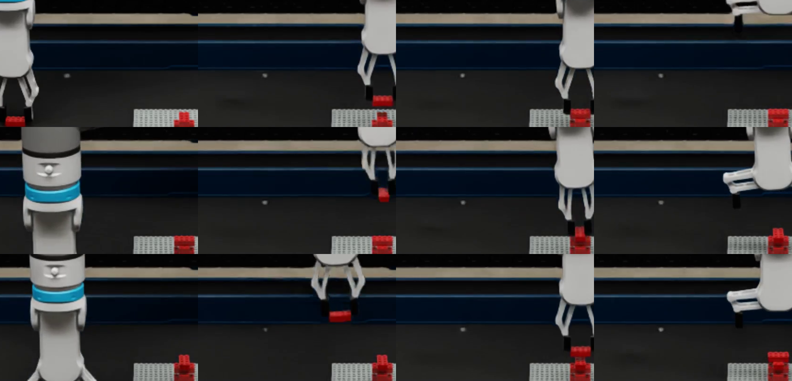
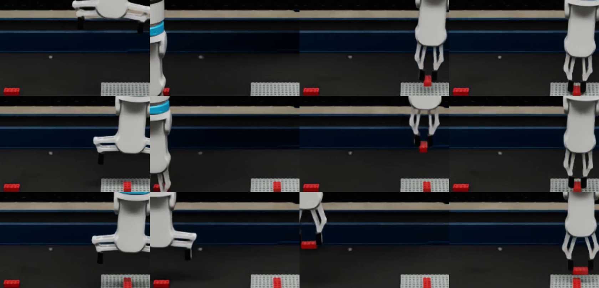
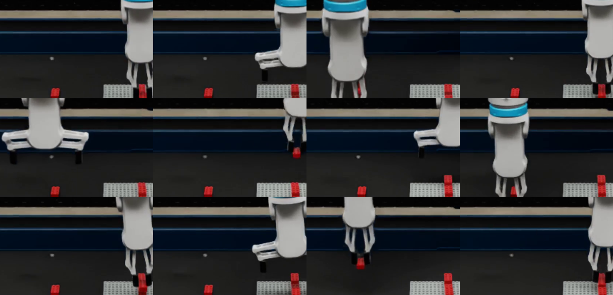

# Structure library

Every structure the UR5e assembly controller builds, one JSON config each (the
dog is [dog.json](dog.json)). Bricks are store sizes from 2x2 to 2x10 (and
6x4), some turned a quarter turn. Build one with:

```bash
OMNI_KIT_ACCEPT_EULA=YES bash experiments/ur5e_assembly/run_loop.sh \
  --attempts 1 --config experiments/ur5e_structures/<name>.json
```

`python3 -m experiments.ur5e_structures.specs` regenerates and validates the
configs; the comments in `specs.py` describe each structure. Per-structure
controller settings and grasp offsets are described in
[docs/USAGE.md](../../docs/USAGE.md#per-structure-settings). The catalog with
pictures, results and videos is [docs/STRUCTURES.md](../../docs/STRUCTURES.md).

Design rule of the first structures: same-layer bricks keep at least a 2-stud (16 mm) gap, the spacing the
dog showed the gripper can place beside. Each brick rests on one brick below with at
least 4 studs of contact and may overhang toward a neighbor. Touching same-layer
bricks were dropped from the first draft.

Besides towers, stairs and other 2x4 builds, the library includes:
- showcase builds (bridge, house, log cabin, locomotive, lighthouse, castle
  gate) and the tree;
- break tests that each push one failure mechanism (lean_ladder,
  cantilever_tip2, cantilever_root2, tower_2x2);
- variants in [attempts/](attempts/): fix attempts, each naming the structure
  it varies (`variant_of`) and how (`variant`), and the dog's seed variants
  (made by `make_dog_seeds.py`), which jitter its pickup positions.

## Failure catalogue

[FAILURES.md](FAILURES.md) lists every structure's result with breakage on, the
mechanism behind each failure, and what to test on the real robot.

## Sweeps

[sweeps/](sweeps/README.md) holds each sweep's definition (configs, settings,
run ids, videos) and its generated summary. The summary keeps apart:
- what stopped the controller;
- contact logging versus fail-on-contact;
- breakage settings;
- breakage-solver warnings versus modeled overloads.

`run_sweep.py` runs a definition and `summarize_sweep.py` summarizes it.

## Trials

Every attempt at a structure, in simulation or on the real UR5e, is one entry in
[trials.json](trials.json); the dashboard (`python3 experiments/ur5e_dashboard/server.py`,
**Structures** filter) shows each structure's layers and trials, and an overview of
the latest result per setting.

After simulation runs, add them from their recordings:

    .venv/bin/python -m experiments.ur5e_structures.record_trials

Add a real-robot trial by hand, with the same fields:

```json
{
  "structure": "tower",
  "kind": "real",
  "platform": "UR5e (lab)",
  "date_utc": "2026-11-10T15:00:00+00:00",
  "breakage": null,
  "bricks_total": 6,
  "bricks_connected": 5,
  "outcome": "failed",
  "failure": "Brick 6 did not seat; brick 4 lifted with it",
  "gripper_contacts": 0,
  "recording": null,
  "notes": "Operator-fed bricks; video: <path or link>"
}
```

`gripper_contacts` counts touches between the gripper and a brick other than the
one being handled (null before contact monitoring). `bricks_connected` counts
bricks still connected at the end, so a joint that broke after forming is not
counted. `outcome` is `completed` when every brick connected and the run ended
cleanly, otherwise `failed` (or `incomplete`/`timeout` for simulation). `breakage` is the
simulator's breakage model (`true`/`false`); use `null` for real trials.

## Results on Isaac Sim 5.1 (simulation, one run each)

| Structure | Bricks | Connections | Outcome |
|---|---|---|---|
| tower | 6 | 6/6 | completed, clean exit |
| l_corner | 4 | 4/4 | completed |
| stairs | 8 | 8/8 | completed |

One run per structure, default pickup grid, yaw 0. No retries exist, so none were used.
Peak contact force per press was 1.0–1.5 N. Poses and snap/weld connections are
simulator ground truth with breakage disabled; this is not perception or physical
insertion. Pickup positions are a placeholder grid, not planned.

## Screenshots

Contact sheets (one frame every 5–8 s) of the plate region, from the 5.1 runs
above. The viewport framing differed from the dog runs and clips the plate at
the screen edge. Full recordings
stay local.




