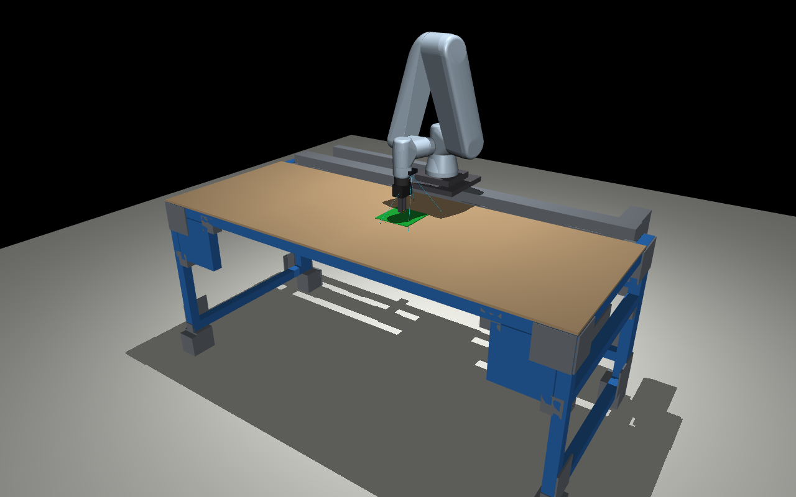
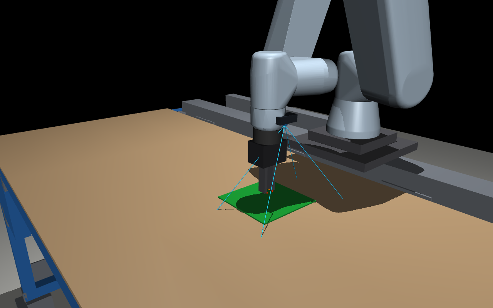

# Mock validation, 2026-11-12

Fake hardware only: `ur_robot_driver` 2.15.0 with `use_fake_hardware:=true`
(`mock_components/GenericSystem`) and `fake_gripper`, on `ROS_LOCALHOST_ONLY=1`.
No robot, gripper or network setting was touched. `mujoco` and `trimesh` were
installed to a scratch directory, not the system. The mock has no force signal,
so the force-limited place and guarded pick are covered by unit tests only.

- `colcon build` and `colcon test`: 94 tests, 0 failures, also from a fresh
  workspace made with `vcs import src < risl.repos` as in the README.
- Dry run, three-brick tower ([dry-run.log](dry-run.log)): 27 steps planned.
  An independent `/joint_states` and `/gripper_command` listener saw no motion
  and no gripper command ([dry-run-observed.json](dry-run-observed.json)).

      ros2 launch risl_contact_assembly assembly.launch.py robot_ip:=0.0.0.0 use_fake_hardware:=true

- Execute, same tower, in the MuJoCo cell viewer, Enter pressed at each of the
  27 prompts ([execute-steps.jsonl](execute-steps.jsonl)). The independent
  listener ([execute-observed.json](execute-observed.json)) measured a peak tool
  speed of 50.2 mm/s, peak joint speed 0.22 rad/s, no tool tilt, and a tool
  path inside the workspace box; final pose is the last retreat target.

      ros2 launch risl_contact_assembly mock_viewer.launch.py

- Cell contacts for that run ([cell-contacts.json](cell-contacts.json)): none in
  4167 checked poses, with a 10 mm clearance on the arm and gripper body.
   
  The images are offscreen renders of the viewer's scene with the third brick
  seated, not captures of the viewer window. The green slab is the taught
  baseplate.
- Negative control, single brick with the bench raised 20 mm
  (`bench_offset_m:="[0.0, 0.0, 0.02]"`): the viewer warned during the run,
  listed both fingers 18.2 mm inside the tabletop and exited with status 1
  ([log](cell-contacts-raised-bench.log), [report](cell-contacts-raised-bench.json)).
- The viewer node publishes only `/rosout` and `/parameter_events`
  (`ros2 node info`), so it cannot command the arm or gripper.
- Aborts ([aborts.log](aborts.log)): empty grasp, Ctrl-C mid-move, and a start
  outside the workspace box each stopped the run.
- Recorder: a pose saved by `record:=true` matched `tf2_echo base tool0` to the
  printed precision (`[0.2154, -0.5335, 0.4134]` m, yaw -171.411 degrees), so
  recorded poses are in `base`, not `base_link`.
- Cancelling a trajectory on the live mock controller stopped the arm and left
  the controller running.
- Launching without `robot_ip` fails with "Required launch argument".
- Real-hardware launch branch, run with the driver include and the
  `risl_onrobot_ros` node removed so nothing could reach a robot: the executor
  started directly, aborted with "no /joint_states: is the driver running?"
  and the launch shut down. The driver and gripper on real hardware are untested.
